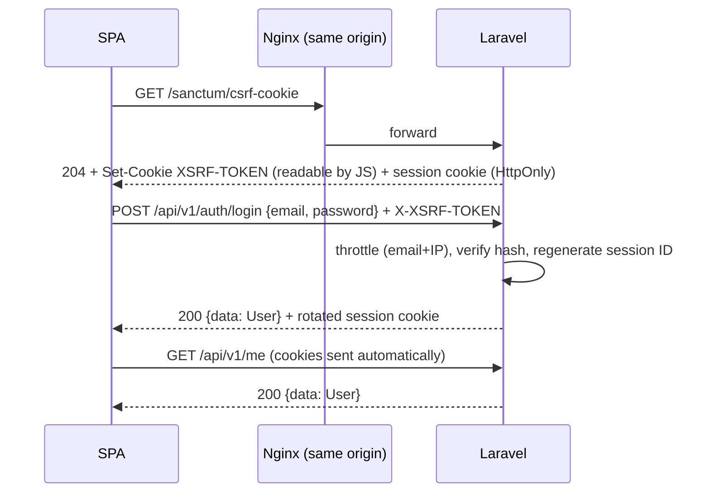

# Authentication and authorization design — Phase 05

**Status:** PROPOSED. It's an independent design built from standard Laravel capabilities.
- **Nothing reused:** none of the reference platform's credentials, secrets, tokens, cookie names, session mechanisms or identity provider is reused or imitated. Phase 03 recorded only *patterns* (session-scoped `me` resources, a CSRF header on writes, `no-store` on personal data). Their values were never displayed or saved.
- **Version check:** verify Sanctum and session configuration names against the current Laravel 13 documentation at implementation time.

## 1. Requirements driving the design
| Requirement | Implication |
|---|---|
| NFR-SEC-01 | Server-side session in an HTTP-only cookie; the member is resolved from the session, never from a user ID in the URL |
| NFR-SEC-02 | CSRF protection on every state-changing request |
| NFR-SEC-03 | `no-store` on personal and cart responses |
| NFR-SEC-04 | HTTPS + HSTS, framing restrictions, CSP, `nosniff`, same-origin API |
| FR-ACC-08 | Registration with one account per e-mail and an 18+ confirmation. Login methods are UNKNOWN (Q-40) |
| NFR-PRV-01 | Minimal personal data; nothing personal in logs or third-party calls |
| NFR-SEC-05 (HYPOTHESIS) | Abuse protection on login and reservation, pending PO validation |
| C-05, Q-71 | Catalogue routes may require a session (`members` mode) |

## 2. Options evaluated
| Option | How it works | Pros | Cons | Fit |
|---|---|---|---|---|
| **Sanctum SPA authentication (stateful cookie session)** | The SPA on the same origin gets the framework session cookie (HTTP-only) after `POST /auth/login`. `auth:sanctum` authenticates by session. CSRF uses an `XSRF-TOKEN` cookie mirrored into the `X-XSRF-TOKEN` header | No token in JS. Revocation = destroy the session. Built-in CSRF. Simplest for a same-origin SPA | Needs the same site (or configured stateful domains). Cookies need CSRF protection. Not suited to third-party API clients | **Best** |
| Sanctum personal access / API tokens | Bearer tokens stored by the client | Good for mobile apps and third parties | A token in JS storage is exposed to XSS; revocation and rotation must be built | Not needed: there are no mobile apps or third-party clients in scope (FR-CNT-05 is Could) |
| Laravel Passport (OAuth 2.0 server) | Full OAuth flows | Standard for delegated third-party access | Heavy; no third-party access is needed | Over-engineered |
| Self-made JWT | Signed stateless tokens | Stateless scaling | Hard revocation; easy to get wrong; tokens in JS | Rejected |
| Plain `web` guard sessions without Sanctum | Session middleware on API routes | Minimal | Re-implements what Sanctum's SPA mode already wires: stateful detection and CSRF cookie route | Viable, but Sanctum is simpler |
| Social login (OAuth client, e.g. Socialite) | Delegated login with an external IdP | Lower friction | Login methods are a PO decision (Q-40). The reference's shared group identity doesn't apply to an independent app | **Deferred** (Q-40). The design allows adding it as an extra login path that creates the same session |

**Decision (ADR-003):**
- **Mechanism:** Sanctum SPA authentication with server-side sessions and CSRF, on one origin served by Nginx.
- **No API tokens** are issued in v1. If a mobile app is commissioned later, Sanctum tokens can be added for that client only, without changing the SPA.

## 3. Flows

### 3.1 Login

### 3.2 Other flows
| Flow | Steps | Class |
|---|---|---|
| Registration | CSRF cookie → `POST /auth/register` → validate (unique e-mail, 18+ accepted, terms accepted with version) → create user + `newsletter_preferences` (all false) → start session → queue the verification e-mail | CONFIRMED (rules) / PROPOSED (flow) |
| Logout | `POST /auth/logout` → invalidate the session, rotate the CSRF token → SPA `resetApiState` | PROPOSED |
| Password reset | `POST /auth/forgot-password` (always 202) → signed, time-limited token by e-mail → `POST /auth/reset-password` → invalidate other sessions of that user | PROPOSED (security baseline; not observed on the reference) |
| E-mail verification | Signed link → `GET /auth/email/verify/{id}/{hash}`. Whether an **unverified** member may reserve is a PO decision (Q-41). Default design: allowed, with a banner | PROPOSED |
| Session expiry | Idle timeout → next API call returns 401 → SPA redirects to login with a return path. An expired session never deletes reservations; they expire on their own timer | PROPOSED |

## 4. Session and cookie settings
| Setting | Value | Reason |
|---|---|---|
| Session driver | `database` (baseline); `redis` optional (ADR-007, Q-72) | No extra service is needed until load says so |
| Session cookie | `HttpOnly`, `Secure`, `SameSite=Lax`, host-only (no `Domain` attribute), application-specific name | XSS can't read it. Lax blocks cross-site POSTs and still allows top-level navigation |
| `XSRF-TOKEN` cookie | Readable by JS (by design), `Secure`, `SameSite=Lax` | The double-submit pattern needs the SPA to read it |
| Session ID regeneration | On login, logout and password change | Prevents session fixation |
| Idle lifetime / "remember me" | **PO decision**, with no silent default. Placeholder settings `session_idle_minutes` and `remember_days` | The reference's session lifetime is unobservable (Q-63) |
| Stateful domains | Only the app's own host(s) per environment | Sanctum treats only these origins as SPA clients |
| CORS | Disabled (same origin) | Removes a whole class of misconfiguration |

## 5. Authorization
**Model:** simple **role column** + **Laravel policies and gates**. This is RBAC with three roles; no permissions package.

| Role | Class | Abilities |
|---|---|---|
| `member` | CONFIRMED (observed role) | Own cart, own account, catalogue reads |
| `merchandiser` | HYPOTHESIS (Q-50) | Gates `manage-campaigns`, `manage-catalog`, `manage-content`, defined but **unused** until a back-office is specified |
| `admin` | HYPOTHESIS (Q-50) | Everything a merchandiser can do, plus `manage-users` |

| Mechanism | Use |
|---|---|
| Route middleware `auth:sanctum` | Every S route (cart, account, `me`, personal rails) |
| `catalog.access` middleware | C routes: requires a session when `catalog_access = members` (Q-71) |
| Policies | `CartReservationPolicy` (owner only), `AccountPolicy` (self only) |
| Resolution by session | Controllers never accept a user ID. Ownership checks give 404 for foreign resources, so nothing leaks |
| `can:` gates | Back-office abilities (future) |

**Why not a permissions package (e.g. a roles/permissions library):** three fixed roles with coarse abilities don't justify a dependency and its tables. Revisit when the back-office specification (Q-50) defines fine-grained permissions.

## 6. Credential and abuse protection
| Control | Design | Class |
|---|---|---|
| Password hashing | The framework default (bcrypt or argon2id), with a rehash on login when parameters change | PROPOSED |
| Password policy | ≥ 12 characters; breached-password check through k-anonymity (only a hash prefix leaves the server). PO may adjust | PROPOSED |
| Login throttling | Per e-mail + IP, e.g. 5 attempts per minute then back-off; per-IP ceiling. Values are placeholders pending Q-42 | PROPOSED |
| Registration and reset throttling | Per IP | PROPOSED |
| Reservation abuse | Cart-write limiter per user and per IP. Bot detection at launch times is pending PO validation (NFR-SEC-05) | PROPOSED, pending PO |
| Enumeration | Generic login errors; forgot-password always 202 ([error-format.md](api/error-format.md) §1) | PROPOSED |
| Logging | Never log passwords, session IDs, CSRF tokens or reset tokens; mask e-mails | CONFIRMED (NFR-PRV-01) |

## 7. Transport and browser hardening (set at Nginx)
- **HSTS:** `Strict-Transport-Security` with a one-year max-age, subdomains included (NFR-SEC-04).
- **CSP:** `Content-Security-Policy`: `default-src 'self'`; scripts and styles from self only; images from self plus the image storage origin; `frame-ancestors 'none'`. The analytics and CMP origins are added only once those tools are chosen.
- **Other headers:** `X-Content-Type-Options: nosniff`, `Referrer-Policy: strict-origin-when-cross-origin`, and a restrictive `Permissions-Policy`.
- **Caching:** `Cache-Control: no-store` on `/api/v1/me`, `/api/v1/cart*`, `/api/v1/account*` and `/api/v1/auth*` (NFR-SEC-03).

## 8. Threat summary
| Threat | Mitigation |
|---|---|
| CSRF | SameSite=Lax + `X-XSRF-TOKEN` double submit on unsafe methods |
| XSS stealing the session | HTTP-only session cookie, strict CSP, React escaping, server-side sanitisation of `content_pages.body` |
| Session fixation | Session ID regeneration at login |
| Credential stuffing | Throttling, breached-password check, generic errors |
| Clickjacking | `frame-ancestors 'none'` |
| IDOR on cart or account | No IDs for the user; ownership policies; 404 on foreign resources |
| Reservation hoarding by bots | Per-user and per-IP limiters, plus the `max_quantity_per_article` limit. Further bot defence pending (NFR-SEC-05) |

## 9. Tradeoffs accepted
- **Cookie sessions tie the API to the browser origin.** A future native app needs a token path, added for that client only.
- **Session storage is server-side.** It's database-backed in the baseline, which adds a write per request. Moving to Redis is a configuration change (ADR-007).
- **Social login deferred:** registration friction may be higher until Q-40 is decided.
