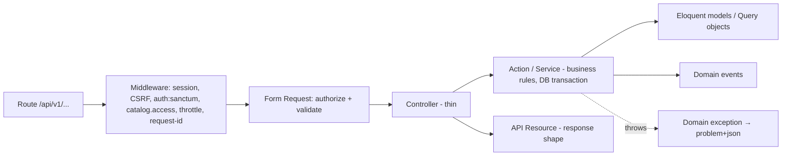

# Laravel backend architecture — Phase 05

**Status:** PROPOSED, unless a row says CONFIRMED.
- **Stack:** Laravel 13 on PHP 8.3+, MySQL 8 (constraint).
- **Version check:** framework details (application bootstrap file, middleware registration, Sanctum setup) follow the long-standing Laravel conventions. **Verify them against the Laravel 13 documentation at implementation time.**
- **No code:** this document contains no implementation code.

## 1. Principles
1. **Modular monolith** (ADR-001). Modules own their tables, models, services, routes and events. Other modules use a module's **public services, events and read models**, never its models' internals or tables directly.
2. **Thin HTTP layer.** Controllers translate HTTP to a single service or action call and return an API Resource. Business rules live in services and actions.
3. **The server is authoritative** for every invariant: live window, stock, reservation expiry, size required. The SPA's checks are only for user experience.
4. **No silent policy defaults.** Policy values come from `config/storefront.php` (system-overview §7). In production the app refuses to boot if any required value is unset (§12).
5. **Eloquent directly. No generic repositories.** A repository layer over Eloquent adds indirection without a second storage backend to justify it. The one complex read path, listing, uses dedicated **query objects** (§6.3).

## 2. Module boundaries
| Module | Owns tables | Public services (examples) | Emits events | Depends on |
|---|---|---|---|---|
| **Identity** | users, password_reset_tokens, sessions | `RegisterMember`, `AuthenticateMember`, `LogoutMember`, password reset | `Registered` (framework), `MemberLoggedIn` | — |
| **Account** | newsletter_preferences, unsubscribe_reasons, garment_groups, saved_size_profiles, saved_size_values | `UpdateNewsletterPreferences`, `Unsubscribe`, `SaveSizeProfiles`, `GetAccountOverview` | `NewsletterPreferencesUpdated` | Identity, Catalog (size systems) |
| **Catalog** | brands, categories, size_systems, products, product_images, product_variants, attributes, attribute_values, product_attribute_values | `CategoryTree`, `BrandDirectory`, `RebuildSearchText` | `ProductChanged`, `BrandChanged` | — |
| **Sales** | landings, landing_campaigns, campaigns, campaign_articles | `LiveCampaigns` (the shared live predicate), `LandingView`, `UpcomingCampaigns`, `CampaignHeadline`, `ArticleLookup` | `CampaignStarted`, `CampaignEnded`, `CampaignChanged` | Catalog |
| **Inventory** | inventory_items | `ReserveUnit`, `ReleaseUnit`, `AvailabilityFor(article)` | — (it's called inside cart transactions) | Sales |
| **Cart** | cart_reservations | `AddToCart`, `RemoveFromCart`, `GetCart`, `ReleaseExpiredReservations` | `ReservationCreated`, `ReservationReleased` (reason: removed / expired) | Inventory, Sales |
| **Listing** (incl. search) | — (read-only over Sales, Catalog, Inventory) | `ArticleListingQuery`, `FacetQuery`, `SearchSuggestions` | — | Sales, Catalog, Inventory |
| **Recommendations** | article_reservation_stats | `RecommendationProvider` interface: `ForYou`, `ContinueShopping`, `Popular` | — | Listing, Cart (events) |
| **Content** | help_categories, content_pages | `HelpTree`, `PageByPath` | — | — |
| **Storefront** | — (configuration) | `StorefrontSettings` | — | — |
| *Checkout* | — | *boundary only (OUT OF SCOPE)*: `ActiveReservationsForCheckout`, `MarkSold` contracts | — | Cart, Inventory |

**Dependencies point one way:** Catalog ← Sales ← Inventory ← Cart, and Listing reads from all three. Two rules keep it that way:
- No module may depend on a module that depends on it. Recommendations reacts to Cart through events, so Cart never calls Recommendations.
- The rule is enforced with an architecture test (namespace dependency rules, e.g. Pest arch tests).

## 3. Request lifecycle (layers)


## 4. Controllers (one per resource, thin)
| Module | Controller | Endpoints ([api-contracts.md](api/api-contracts.md)) |
|---|---|---|
| Identity | `SessionController`, `RegistrationController`, `PasswordResetController`, `EmailVerificationController`, `CurrentUserController` | §2 |
| Storefront | `StorefrontSettingsController`, `NavigationController` | §3 |
| Sales | `LandingController`, `UpcomingCampaignController`, `CampaignController`, `CampaignArticleController` | §4 |
| Listing | `ArticleListingController`, `ArticleFacetController`, `SearchSuggestionController` | §5, §6 |
| Catalog | `BrandController`, `CategoryController` | §5 |
| Cart | `CartController`, `CartItemController` | §7 |
| Account | `AccountOverviewController`, `ProfileController`, `NewsletterPreferenceController`, `NewsletterUnsubscribeController`, `SavedSizeController` | §8 |
| Recommendations | `RecommendationController` | §6.4 |
| Content | `HelpController`, `ContentPageController` | §9 |

## 5. Form Requests (validation and authorization at the boundary)
| Request | Key rules | Requirement |
|---|---|---|
| `RegisterRequest` | email (valid, unique), password (min length, breached-password check PROPOSED), first_name, `adult_confirmed` accepted, `terms_accepted` accepted | FR-ACC-08 |
| `LoginRequest` | email, password; throttled | NFR-SEC-01 |
| `ListArticlesRequest` | exactly one context (`campaign`, `category`, `brand`, `q`, `collection=top-picks`); `sort` in the 5 values; `filter[size][]`, `filter[brand][]`, `filter[attr][code][]`, `filter[price_min]` ≤ `filter[price_max]` (whole euros); `page[number]` ≥ 1; `page[size]` capped by settings | FR-CAT-01–09 |
| `SearchSuggestionRequest` | `q` length ≥ 1 (minimum length UNKNOWN, Q-44), ≤ 100 | FR-SRC-01 |
| `AddCartItemRequest` | `sku` exists; `variant_id` **required** (error code `size_required`, message "Choisissez une taille"); `quantity` 1…`max_quantity_per_article` | FR-PDP-02, FR-PDP-03 |
| `UpdateNewsletterPreferencesRequest` | booleans `daily_sales`, `weekly_sales`, `personalisation_opt_in` | FR-ACC-05 |
| `UnsubscribeRequest` | `reason_id` **required**, must exist and be active | FR-ACC-06 |
| `SaveSizeProfilesRequest` | per profile: gender in {women, men}, garment group exists, size system exists, sizes valid for that system | FR-ACC-07 |
| `UpdateProfileRequest` | first_name. Further fields UNKNOWN (Q-41) | FR-ACC-01 |

## 6. Services and actions

### 6.1 Cart and inventory (the transactional core)
| Action | Behaviour | Class |
|---|---|---|
| `AddToCart` | In one DB transaction: (1) load the article and check the campaign is **live**. That guard is PROPOSED, pending PO validation (FR-CMP-08), and controlled by one switch. (2) Check the per-member quantity limit (Q-46). (3) `Inventory::ReserveUnit`: a conditional atomic update, failing with `OutOfStock` (409). (4) If a row for the same (user, inventory item) exists but **has expired** (not yet swept), release it first through `ReleaseUnit` in the same transaction, so it neither counts against the limit nor leaks reserved stock. (5) Upsert `cart_reservations` with `expires_at` per `reservation_timer_mode` (Q-32). (6) Commit, then emit `ReservationCreated` after commit | CONFIRMED (reserve, 20-min timer) / PROPOSED (guard, timer mode) |
| `RemoveFromCart` | Transaction: delete the reservation, decrement `quantity_reserved`, emit `ReservationReleased(removed)` | CONFIRMED (FR-CRT-04) |
| `ReleaseExpiredReservations` | Every minute: batches of ≤ 500 rows `expires_at <= now`. Each batch is one transaction using `ReleaseUnit`; emits `ReservationReleased(expired)` | PROPOSED, pending PO validation (FR-CRT-08) |
| `GetCart` | Active reservations only (`expires_at > now`), lines, savings vs RRP, total, `expires_at` | CONFIRMED (FR-CRT-03, FR-CRT-05) |

### 6.2 Sales
- **`LiveCampaigns`:** the **single** implementation of the live predicate, with a request-scoped "now" instant (ADR-009). Everything that filters by live status calls it.
- **`CampaignHeadline`:** computed, manual or special (Q-23).
- **`UpcomingCampaigns`:** global list (FR-UPC-03) within `upcoming_horizon_hours` (Q-74).
- **`LandingView`:** hero, grid, upcoming section according to the landing type, and personal rails only on the default landing (FR-REC-01).

### 6.3 Listing query objects (why not repositories)
`ArticleListingQuery` and `FacetQuery` compose context, filters, sort and pagination from validated input. Both use the shared live predicate.
- **Why query objects:** they're the one place complex SQL lives, and they're tested against seed data (indexing-strategy §6).
- **Why not repositories:** a generic repository would hide exactly the query shape that needs tuning.

### 6.4 Recommendations
- **Interface:** `RecommendationProvider` has three named strategies.
- **v1 bindings (PROPOSED, Q-29):**
  - `ForYou` → empty
  - `ContinueShopping` → empty
  - `Popular` → top 12 live articles by reservations in the last 24 h, from `article_reservation_stats`, with no regional dimension (Q-78)
- **Front end:** empty rails are hidden.

## 7. Models
- **One Eloquent model per table** in its module, with relations matching [erd.md](database/erd.md).
- **Naming:** the landing model is called `Landing` to avoid confusion with Laravel events.
- **Casts:**
  - money → integer cents with a `Money` value object (Support)
  - datetimes → UTC immutable dates
  - enums → PHP backed enums (`Role`, `LandingType`, `HeadlineMode`, `PageType`, `Gender`)
- **Mass assignment:** `$fillable` is explicit everywhere, never `$guarded = []`.
- **No business logic in model events.** Side effects go through domain events emitted by services.

## 8. Policies (authorization)
| Policy | Rule | Requirement |
|---|---|---|
| `CartReservationPolicy` | A member can view and delete only their own reservations. The API never takes a user ID; it resolves `me` from the session | NFR-SEC-01 |
| `AccountPolicy` | Account resources are scoped to the authenticated user | NFR-SEC-01 |
| `CatalogAccess` middleware (not a policy) | `catalog_access = members` requires authentication for catalogue routes; `public` allows anonymous reads (Q-71) | C-05 |
| Back-office abilities (`manage-campaigns`, `manage-catalog`, `manage-content`) | Gates on `role ∈ {merchandiser, admin}`. Defined but unused in v1 (no admin API, Q-50) | PROPOSED |

## 9. API Resources
| Resource | Notes |
|---|---|
| `LandingResource`, `CampaignTileResource`, `UpcomingCampaignResource` | Timestamps as ISO-8601 UTC. `state` is derived; `headline` is `{type: percent|special, value}` |
| `ArticleTileResource`, `ArticleDetailResource` | Money as `{amount_cents, currency: "EUR"}`, `discount_percent`, images with alt text, sizes with `availability`. `low_stock_quantity` is exposed only at or below the threshold |
| `CartResource` | Lines, `savings_cents`, `total_cents`, `expires_at`, `excludes_packaging_and_handling: true` (FR-PRC-02) |
| `FacetResource`, `BrandSuggestionResource`, `HelpPageResource`, `UserResource` | `UserResource` never exposes the role to other users and has no internal IDs beyond what the SPA needs |

**All responses** carry `meta.server_time`, the UTC instant, so countdowns don't depend on client clocks (FR-CMP-02, FR-CRT-02). It's added by one response middleware.

## 10. Events, listeners, jobs and scheduling
| Trigger | Listener / job | Queue | Class |
|---|---|---|---|
| `ReservationCreated` | `IncrementArticleReservationStats` | `default` (async) | PROPOSED |
| `CampaignStarted`, `CampaignEnded`, `CampaignChanged` | `InvalidateLandingCaches`, `InvalidateCampaignHeadline` | sync (cheap) | PROPOSED |
| `ProductChanged`, `BrandChanged` | `RebuildProductSearchText` | `default` | PROPOSED (ADR-008) |
| `Registered` | send e-mail verification | `default` | PROPOSED |
| Password reset requested | send reset e-mail | `default` | PROPOSED |
| `NewsletterPreferencesUpdated` | sync to the marketing tool | — | UNKNOWN (tool not chosen) |
| Scheduler, every minute | `cart:release-expired` (ReleaseExpiredReservations) | runs in the scheduler | PROPOSED (FR-CRT-08) |
| Scheduler, every minute | `sales:emit-boundaries`: emits `CampaignStarted`/`CampaignEnded` for boundaries crossed since the last run, using a stored watermark so none are missed | runs in the scheduler | PROPOSED |
| Scheduler, daily | `recommendations:prune-stats` (keeps 7 days) | runs in the scheduler | PROPOSED |

- **Queue driver:** `database` as the baseline; Redis optional (ADR-007, Q-72).
- **Failed jobs:** go to `failed_jobs`. Listeners are idempotent: cache invalidation and stats increments are safe to retry, apart from rare double counting, which is acceptable for popularity.

## 11. Exception handling
- **Format:** one renderer maps exceptions to the error format in [api/error-format.md](api/error-format.md), which is RFC 9457 problem details. It's registered in the application's exception configuration.
- **Domain exceptions:** each carries a stable `code`.

| Exception | HTTP | `code` |
|---|---|---|
| Validation failure | 422 | `validation_failed` (field errors; e.g. `size_required`) |
| `OutOfStock` | 409 | `out_of_stock` |
| `ReservationLimitReached` | 409 | `reservation_limit_reached` |
| `CampaignNotLive` | 409 | `campaign_not_live` (PROPOSED guard) |
| `CampaignEnded` (resource read) | 410 | `campaign_ended` (PROPOSED, Q-17) |
| `CampaignNotYetStarted` (resource read) | 404 | `not_found`. PROPOSED: refuses upcoming campaigns server-side and doesn't reveal their existence (the reference's server-side enforcement of BR-03-11 is a HYPOTHESIS) |
| Unauthenticated | 401 | `unauthenticated` |
| Forbidden / policy | 403 | `forbidden` |
| Model not found | 404 | `not_found` |
| CSRF token mismatch | 419 | `csrf_token_mismatch` |
| Throttled | 429 | `rate_limited` (+ `Retry-After`) |
| Anything else | 500 | `server_error`. No stack trace or SQL in the body; logged with the request ID |

## 12. Configuration and storefront settings
- **One source:** `config/storefront.php` holds the policy values listed in system-overview §7. They're read from environment variables and exposed through `StorefrontSettings`, and publicly through `GET /storefront/settings` (only the values the SPA needs).
- **Fail fast:** a boot-time check fails in production when a required policy value is missing. Local and test environments use clearly labelled **development placeholders** in a `.env.example`, to be written in the implementation phase.
- **Feature switches** for the HYPOTHESIS behaviours are each one boolean, so the PO can decide without code changes:
  - `enforce_live_window_on_add` (FR-CMP-08)
  - `release_expired_reservations` (FR-CRT-08)
  - `hide_add_button_after_add` (FR-PDP-04; front-end behaviour, also exposed in settings)
  - `last_hours_badge` (FR-STK-03)

## 13. Authentication (summary)
- **Sessions:** Sanctum **SPA authentication** with stateful cookie sessions on the same origin, the `XSRF-TOKEN` cookie and `X-XSRF-TOKEN` header, and `auth:sanctum` on protected routes.
- **No API tokens** are issued.
- Detail is in [authentication-design.md](authentication-design.md).

## 14. Validation strategy
1. **Syntax and shape:** Form Requests on every write and every parameterised read. Unknown query parameters are rejected (422) rather than ignored, so typos in filters surface.
2. **Business invariants:** in services, inside the transaction (live window, stock, limits). The client can't bypass them.
3. **Database:** UNIQUE, FK and CHECK constraints as the last line (schema.md).
4. **Messages:** French validation messages (`lang/fr`), with plural-aware wording (NFR-I18N-02). The error `code` is stable for the SPA; the `detail` is human text.

## 15. Cross-cutting
| Concern | Design | Requirement |
|---|---|---|
| Request ID | Middleware accepts or creates `X-Request-Id`, adds it to the log context and returns it | NFR-OBS-01 |
| Rate limiting | Named limiters: login (per email + IP), registration, cart writes (per user), search suggestions (per session). Values are placeholders pending Q-42 | NFR-SEC-05 (PROPOSED) |
| Security headers | Set at Nginx: HSTS, CSP, `X-Frame-Options`/`frame-ancestors`, `nosniff`, `Referrer-Policy` | NFR-SEC-04 |
| Cache-Control | `no-store` on cart, account, session and settings responses; short public caching only for anonymous catalogue reads in `public` mode | NFR-SEC-03 |
| Logging | Structured JSON logs. Never log passwords, session IDs or CSRF tokens; e-mail addresses are masked | NFR-PRV-01 |
| Time | A request-scoped clock with one "now" per request; UTC everywhere (ADR-009) | NFR-TIME-01 |

## 16. Proposed directory structure
```text
app/
├── Modules/
│   ├── Identity/
│   │   ├── Http/{Controllers,Requests,Resources}/
│   │   ├── Actions/            (RegisterMember, AuthenticateMember, ...)
│   │   ├── Models/             (User)
│   │   ├── Events/
│   │   ├── routes.php          (included by routes/api.php under /api/v1)
│   │   └── IdentityServiceProvider.php
│   ├── Account/
│   │   ├── Http/{Controllers,Requests,Resources}/
│   │   ├── Actions/            (UpdateNewsletterPreferences, Unsubscribe, SaveSizeProfiles)
│   │   ├── Models/             (NewsletterPreference, UnsubscribeReason, GarmentGroup, SavedSizeProfile, SavedSizeValue)
│   │   ├── Policies/
│   │   └── routes.php
│   ├── Catalog/
│   │   ├── Http/…  Models/ (Brand, Category, Product, ProductImage, ProductVariant, SizeSystem, Attribute, AttributeValue)
│   │   ├── Services/           (CategoryTree, BrandDirectory, RebuildSearchText)
│   │   └── Events/ Listeners/
│   ├── Sales/
│   │   ├── Http/…  Models/ (Landing, Campaign, CampaignArticle)
│   │   ├── Services/           (LiveCampaigns, LandingView, UpcomingCampaigns, CampaignHeadline)
│   │   ├── Console/            (EmitCampaignBoundaries)
│   │   └── Events/
│   ├── Inventory/
│   │   ├── Models/ (InventoryItem)
│   │   └── Services/           (ReserveUnit, ReleaseUnit, Availability)
│   ├── Cart/
│   │   ├── Http/…  Models/ (CartReservation)  Policies/
│   │   ├── Actions/            (AddToCart, RemoveFromCart, GetCart)
│   │   ├── Console/            (ReleaseExpiredReservations)
│   │   └── Events/
│   ├── Listing/
│   │   ├── Http/…
│   │   └── Queries/            (ArticleListingQuery, FacetQuery, SearchSuggestions)
│   ├── Recommendations/
│   │   ├── Contracts/          (RecommendationProvider)
│   │   ├── Providers/          (EmptyProvider, PopularByReservations)
│   │   ├── Models/ (ArticleReservationStat)  Listeners/
│   │   └── Console/            (PruneStats)
│   ├── Content/
│   │   └── Http/…  Models/ (HelpCategory, ContentPage)
│   └── Storefront/
│       └── Http/…  Services/ (StorefrontSettings)
├── Support/                    (Money, RequestClock, ProblemDetails renderer, RequestId middleware)
config/storefront.php           (policy values — names only until the PO decides)
database/{migrations,seeders,factories}/   (per-module subfolders)
lang/fr/                        (validation and domain messages)
routes/api.php                  (/api/v1 prefix, includes module route files)
tests/{Feature,Unit,Architecture}/
```
Module service providers are registered in the application's provider list. Migrations live in per-module subfolders that the framework is configured to load.

## 17. Testing strategy (documentation only)
| Level | Focus |
|---|---|
| Architecture tests | Module dependency direction (§2); controllers don't touch models of other modules |
| Feature tests (HTTP) | Every acceptance criterion in [acceptance-criteria.md](../requirements/acceptance-criteria.md) that the API can observe, e.g. AC-FR-PDP-02-1 (422 `size_required`) and AC-FR-CRT-04-2 (release) |
| Concurrency test | N parallel adds on one unit, so exactly one succeeds (NFR-CON-01) |
| Time-travel tests | Lifecycle boundaries (FR-CMP-05), expiry (FR-CRT-08), countdown inputs, all using the request clock. Includes **re-adding the same size after expiry but before the sweep**: the stale row is released first, `quantity_reserved` is unchanged overall, and the limit isn't hit |
