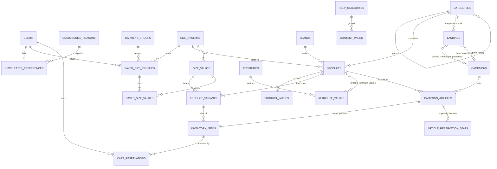
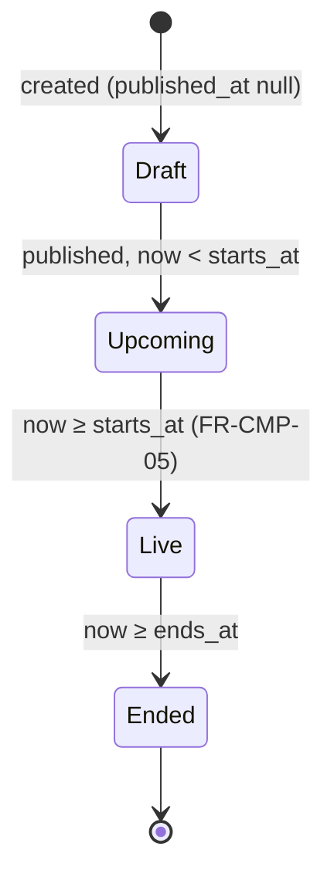
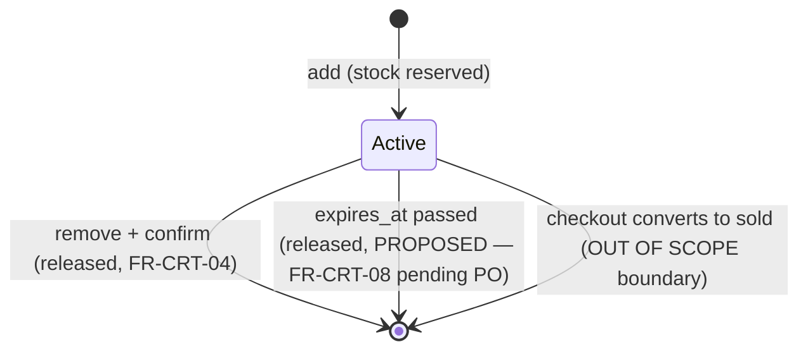

# Entity–relationship model — Phase 05

**Scope:**
- **Covered:** the domain entities of the authorized functional scope. The candidate evaluation (include, merge or exclude) is in [system-overview.md §8](../system-overview.md).
- **Tables:** column-level detail is in [schema.md](schema.md), and indexes are in [indexing-strategy.md](indexing-strategy.md).
- **Labels:** CONFIRMED / PROPOSED / UNKNOWN, as in system-overview §1.

## 1. Diagram

## 2. Entities

### 2.1 Identity and account

#### User (`users`)
- **Purpose:** a registered member who can browse, reserve and manage the account.
- **Attributes:**
  - email (login)
  - password hash
  - first name (greeting, FR-ACC-02)
  - email verification time
  - adult confirmation time (18+)
  - terms acceptance time
  - role
- **Relationships:** 1–0..1 NewsletterPreference, 1–n SavedSizeProfile, 1–n CartReservation.
- **Constraints:**
  - Email is unique. This is the enforceable part of "one account per customer" (BR-15-02).
  - The adult confirmation is required at registration.
  - The role is one of `member`, `merchandiser`, `admin`. Only `member` is CONFIRMED; the others are HYPOTHESIS roles (Q-50).
- **Lifecycle:** registered → (verified) → active. Deletion and anonymisation are UNKNOWN (Q-73). No soft delete in v1.
- **Source:** FR-ACC-08, FR-ACC-02, NFR-SEC-01. **Class:** CONFIRMED (entity) / UNKNOWN (registration fields beyond the minimum, Q-41; login methods, Q-40).

#### NewsletterPreference (`newsletter_preferences`)
- **Purpose:** the member's choice of sales e-mails and the personalisation opt-in.
- **Attributes:** daily sales, weekly sales, personalisation opt-in, unsubscribed time, unsubscribe reason.
- **Relationships:** 1–1 User; n–0..1 UnsubscribeReason.
- **Constraints:**
  - Unsubscribing requires a reason (BR-15-04).
  - All opt-ins start false. That's PROPOSED: consent must be opt-in (NFR-PRV-01).
- **Lifecycle:** created with the user → updated → unsubscribed (reason stored) → may resubscribe.
- **Source:** FR-ACC-05, FR-ACC-06. **Class:** CONFIRMED. The reason list values are UNKNOWN.

#### UnsubscribeReason (`unsubscribe_reasons`)
- **Purpose:** the reason options offered when unsubscribing.
- **Attributes:** label, position, active flag.
- **Relationships:** 1–n NewsletterPreference (as the stored reason).
- **Constraints:** a label is required; a reason in use is deactivated, never deleted (FK restrict).
- **Lifecycle:** created by the PO/back-office → active → inactive (kept for history).
- **Source:** FR-ACC-06. **Class:** CONFIRMED (a list exists) / UNKNOWN (values).

#### GarmentGroup, SavedSizeProfile, SavedSizeValue
- **Purpose:** the member's saved sizes per gender and garment group, in one size system.
- **Attributes:**
  - **GarmentGroup:** code, name, position.
  - **SavedSizeProfile:** user, gender (`women`/`men`), garment group, size system.
  - **SavedSizeValue:** profile, size value (from the profile's size system).
- **Relationships:** User 1–n SavedSizeProfile; GarmentGroup 1–n SavedSizeProfile; SizeSystem 1–n SavedSizeProfile; SavedSizeProfile 1–n SavedSizeValue; SizeValue 1–n SavedSizeValue.
- **Constraints:** one profile per (user, gender, garment group). One size system per profile, matching the radio choice in the reference UI.
- **Lifecycle:** created or replaced on save, deleted when emptied.
- **Source:** FR-ACC-07, BR-15-05. **Class:** CONFIRMED. Groups observed: Chaussures, Hauts / Tops, Pantalons, Robes et jupes, Lingerie et maillot de bain. Using them to pre-filter listings is HYPOTHESIS (Q-39), so it isn't designed.

### 2.2 Catalogue

#### Brand (`brands`)
- **Purpose:** the maker shown on tiles, the PDP heading, brand pages and search suggestions.
- **Attributes:** code (public, used in `/brands/{code}`), display name, slug.
- **Relationships:** 1–n Product.
- **Constraints:** the code and slug are unique. The breadcrumb shows the **name**, never the code (FR-BRD-02).
- **Lifecycle:** created by the back-office (UNKNOWN, Q-50). It can't be deleted while products reference it (FK restrict).
- **Source:** FR-BRD-01, FR-BRD-02, FR-SRC-01. **Class:** CONFIRMED.

#### Category (`categories`)
- **Purpose:** a tree used for the mega-menu columns and category listings.
- **Attributes:** parent, name, slug, position, materialised path.
- **Relationships:** self-referencing tree. 1–n Product (leaf assignment). 0..1–n Landing (mega-menu root).
- **Constraints:**
  - The slug is unique among siblings.
  - A product is assigned to one category (PROPOSED). Listings for a node include its descendants.
- **Lifecycle:** maintained by the back-office (UNKNOWN).
- **Source:** FR-NAV-04, FR-CAT-04. **Class:** CONFIRMED (tree, listings) / PROPOSED (single assignment).

#### Product (`products`)
- **Purpose:** a catalogue product, independent of any sale. It holds the brand, type, details, composition, manufacturing information, images and its size system.
- **Attributes:**
  - brand, category, size system
  - model code, name/type
  - details text, size & fit text, composition text, manufacturing text
  - delivery lead time (min/max days)
- **Relationships:** n–1 Brand, Category, SizeSystem. 1–n ProductImage, ProductVariant, CampaignArticle. n–m AttributeValue.
- **Constraints:**
  - The model code isn't globally unique: one model can exist in several colours (Q-70).
  - Colour, composition and length filter values come from attribute values (FR-CAT-04).
- **Lifecycle:** created → used by campaign articles → can't be deleted while articles reference it.
- **Source:** FR-PDP-01, FR-PDP-06 (each product has its own delivery time, BR-17-02), FR-CAT-02. **Class:** CONFIRMED (fields shown) / UNKNOWN (granularity, Q-70).

#### ProductImage (`product_images`)
- **Purpose:** the gallery and tile images.
- **Attributes:** path, alt text (required), position.
- **Relationships:** n–1 Product (owned, cascade on product delete).
- **Constraints:** one image per position per product. Alt text is required (NFR-A11Y-01).
- **Lifecycle:** uploaded with the product → reordered or replaced → deleted with the product.
- **Source:** FR-PDP-01, FR-CAT-02. **Class:** CONFIRMED.

#### SizeSystem (`size_systems`)
- **Purpose:** the system a size label belongs to. It drives the size-filter tabs and the saved-size systems.
- **Attributes:** code, display name. It has 1–n **SizeValue** (label, sort order): the valid sizes of the system, shared by variants and saved sizes.
- **Relationships:** 1–n SizeValue; 1–n Product; 1–n SavedSizeProfile. SizeValue 1–n ProductVariant and 1–n SavedSizeValue.
- **Constraints:** the system code is unique; a size label is unique within its system; a size value in use can't be deleted (FK restrict).
- **Lifecycle:** reference data seeded at setup, extended by the back-office (UNKNOWN, Q-50).
- **Source:** FR-CAT-06, FR-ACC-07, FR-PDP-08. **Class:** CONFIRMED ("Chaussures" tab; EU/US).

#### ProductVariant (`product_variants`)
- **Purpose:** one size of a product, as selected on the PDP.
- **Attributes:** product, size value (e.g. "39 1/3").
- **Relationships:** n–1 Product; n–1 SizeValue; 1–n InventoryItem.
- **Constraints:** one variant per (product, size value), and the size value must belong to the product's size system.
- **Lifecycle:** created with the product.
- **Source:** FR-PDP-02, FR-PDP-08. **Class:** CONFIRMED.

#### Attribute, AttributeValue, ProductAttributeValue
- **Purpose:** filterable and displayable product facets (Couleur, Composition, Longueur…).
- **Attributes:**
  - **Attribute:** code, name, filterable flag, position.
  - **AttributeValue:** attribute, value, slug.
- **Relationships:** Attribute 1–n AttributeValue; Product n–m AttributeValue (through ProductAttributeValue).
- **Constraints:** a product has 0..n values per attribute.
- **Context dependence:** a facet is offered for a listing only if the result set has values for it. This is how "Longueur" can appear on category listings only (BR-06-08). That's a PROPOSED reading of a CONFIRMED observation.
- **Lifecycle:** attributes and values are reference data maintained by the back-office (UNKNOWN, Q-50); product links are set with the product and rebuild `products.search_text` (ADR-008).
- **Source:** FR-CAT-04, FR-PDP-01. **Class:** CONFIRMED (filters exist) / UNKNOWN (values in the Marque, Couleur and Composition dialogs, Q-14).

### 2.3 Sales (merchandising)

#### Landing (`landings`), domain term "event landing"
- **Purpose:** a storefront page: the default "all sales" landing, verticals and curated pages.
- **Attributes:**
  - public numeric ID (used in `/event/{id}`), slug, title
  - type (`aggregate`, `vertical`, `curated`)
  - default flag, main-nav position
  - mega-menu root category
  - hero (image, alt text, title, target campaign)
- **Relationships:** n–m Campaign (ordered). 0..1 Category (menu root). 0..1 Campaign (hero target).
- **Constraints:**
  - Exactly one default landing.
  - An `aggregate` landing lists **all** live campaigns, so every vertical campaign is also on "all sales" (BR-05-03).
  - A `vertical` landing lists only its assigned live campaigns.
  - A `curated` landing hides the upcoming section and the footer. That's PROPOSED, pending PO validation (FR-EVT-05).
  - A null menu root means no mega-menu (FR-NAV-04).
  - The hero applies to verticals only (FR-EVT-04).
- **Lifecycle:** configured by the back-office (UNKNOWN, Q-50).
- **Source:** FR-EVT-01–05, FR-NAV-03, FR-NAV-04. **Class:** CONFIRMED / PROPOSED (types) / HYPOTHESIS (hero target, BR-11-02).

#### LandingCampaign (`landing_campaigns`)
- **Purpose:** assigns a campaign to a landing, with a position.
- **Attributes:** landing, campaign, position (nullable).
- **Relationships:** n–1 Landing; n–1 Campaign (both cascade on delete).
- **Constraints:** a campaign appears at most once per landing.
- **Ordering:** by position, then by start time descending. Merchandising order is PROPOSED, pending PO validation (FR-EVT-03).
- **Lifecycle:** created when a campaign is assigned to a vertical or curated landing; optional on the aggregate landing (ordering override only); removed when unassigned.
- **Source:** FR-EVT-02, FR-EVT-03, BR-03-13. **Class:** CONFIRMED (many-to-many) / PROPOSED (ordering).

#### Campaign (`campaigns`)
- **Purpose:** a time-boxed sale.
- **Attributes:**
  - name, slug, image, image alt text
  - start, end (UTC)
  - headline mode (`computed`, `manual`, `special`) and the manual headline percentage
  - publication time
- **Relationships:** n–m Landing. 1–n CampaignArticle.
- **Constraints:**
  - The end is after the start.
  - A manual percentage is set only for the `manual` mode.
  - The headline: `computed` = the maximum `discount_percent` over the campaign's articles (BR-12-05), `manual` = the stored value, `special` = the "Special" label (FR-CMP-04). Which mode applies is UNKNOWN (Q-23, Q-24), so all three are supported.
- **Lifecycle (state is derived, never stored):**

  - State = f(`published_at`, `starts_at`, `ends_at`, now). This avoids a status column that a missed job could leave stale.
  - The scheduler only **emits** `CampaignStarted` / `CampaignEnded` events for cache invalidation; it never changes state.
  - Editing times after the start is UNKNOWN (Q-50).
  - What an ended campaign's URL returns is UNKNOWN (Q-17). The API returns `410 campaign_ended` (PROPOSED).
- **Source:** FR-CMP-01–05, FR-CMP-09, FR-UPC-01. **Class:** CONFIRMED (states and transition) / PROPOSED (derived state, headline modes).

#### CampaignArticle (`campaign_articles`), the brief's "CampaignProduct"
- **Purpose:** the sellable article: one product inside one campaign, with its SKU, RRP and sale price.
- **Attributes:** campaign, product, SKU, RRP (cents), sale price (cents), discount % (generated), merchandising position.
- **Relationships:** n–1 Campaign, Product. 1–n InventoryItem.
- **Constraints:**
  - The SKU is globally unique (it's in the URL, FR-CMP-06).
  - One article per (campaign, product). The same product in another campaign is another article, with its own SKU and prices (FR-CMP-07, ADR-004). That a sellable item can be in several campaigns **at once** is PROPOSED (Q-70).
  - `0 < sale_price ≤ RRP`.
  - Prices include VAT (BR-12-02).
- **Lifecycle:** created when the campaign is assembled. Price changes during a live campaign are UNKNOWN (Q-50).
- **Purchase window:** purchasable only while the campaign is live. PROPOSED, pending PO validation (FR-CMP-08).
- **Source:** FR-CMP-06, FR-CMP-07, FR-PRC-01, FR-CAT-02, FR-CAT-03. **Class:** CONFIRMED (campaign-scoped addressing, RRP vs sale price) / PROPOSED (price on the article).

### 2.4 Inventory and cart

#### InventoryItem (`inventory_items`)
- **Purpose:** limited stock of one size of one campaign article.
- **Attributes:**
  - article, variant, product (for integrity)
  - allocated, reserved, sold (sold is written by checkout, OUT OF SCOPE)
  - available (generated)
- **Relationships:** n–1 CampaignArticle; n–1 ProductVariant; 1–n CartReservation.
- **Constraints:**
  - One row per (article, variant).
  - The variant must belong to the article's product. A composite foreign key on `product_id` enforces this.
  - `reserved + sold ≤ allocated`.
  - Stock is never replenished during a campaign (FR-STK-02). There's no restock use case.
- **Lifecycle:** allocated → reserved/released (cart) → sold (checkout boundary).
- **Source:** FR-STK-01, FR-STK-02, FR-PDP-05, NFR-CON-01. **Class:** CONFIRMED (limited, reserved units unavailable) / PROPOSED (per-campaign scope, Q-70; counter design, ADR-005).

#### CartReservation (`cart_reservations`), the brief's "CartItem"
- **Purpose:** a unit reserved by a member for a limited time. The cart is the member's set of active reservations.
- **Attributes:** user, inventory item, quantity, reserved at, expires at.
- **Relationships:** n–1 User; n–1 InventoryItem.
- **Constraints:**
  - One row per (user, inventory item).
  - The quantity is at most `max_quantity_per_article` (UNKNOWN, Q-46).
  - `expires_at = reserved_at + reservation_minutes` (UNKNOWN value; 20 on the reference). Q-32 decides whether a new item resets a shared timer. Storing the expiry per row supports both modes.
- **Lifecycle:**

  Released rows are deleted. There's no history table, because no requirement needs one.
- **Source:** FR-CRT-01–08, FR-PDP-03, FR-NAV-05. **Class:** CONFIRMED / PROPOSED (expiry).

#### ArticleReservationStat (`article_reservation_stats`)
- **Purpose:** hourly reservation counts per article. They feed the PROPOSED "popular" rail strategy (FR-REC-02, Q-29, Q-78).
- **Attributes:** campaign article, hour bucket (UTC), reservation count.
- **Relationships:** n–1 CampaignArticle (cascade).
- **Constraints:** one row per (article, hour bucket); counts ≥ 0.
- **Lifecycle:** incremented by the `ReservationCreated` listener; buckets older than 7 days are pruned (PROPOSED).
- **Source:** FR-REC-02 (display CONFIRMED); strategy PROPOSED (Q-29, Q-78).
- **Class:** PROPOSED. Remove it if the PO picks another strategy.

### 2.5 Content

#### HelpCategory (`help_categories`), ContentPage (`content_pages`)
- **Purpose:** help articles at `/help/<category>/<slug>`, and legal pages (terms, legal notice, privacy).
- **Attributes:**
  - **HelpCategory:** slug, title, position.
  - **ContentPage:** type (`help`/`legal`), category, unique path, title, sanitised body, version (terms), publication time.
- **Relationships:** HelpCategory 1–n ContentPage (help pages only; legal pages have no category).
- **Constraints:** the path is unique. The terms have a version (the reference shows a CGV version date).
- **Lifecycle:** draft (`published_at` null) → published → updated in place. A new terms version is a new `version` value, and members record the version they accepted (`users.terms_version`). Editing is a back-office function (UNKNOWN, Q-50).
- **Source:** FR-CNT-02, FR-CNT-03, FR-DLV-01, FR-PRC-02. **Class:** CONFIRMED. The texts are PO/legal content (Q-48); reference text must not be copied.

## 3. Relationship consistency notes
- **No cycles in ownership.** Catalogue entities don't depend on sales. Sales reference the catalogue. Inventory references sales and the catalogue. Cart references inventory.
- **Live-only rule:** grid visibility (FR-EVT-02), listing visibility, search results (FR-SRC-02) and reservations all use one "live" predicate (ADR-009).
- **Checkout-owned data:** `inventory_items.quantity_sold`, orders and returns belong to the future checkout specification. Only `quantity_sold` exists here, so availability can be computed; nothing in scope writes it.
