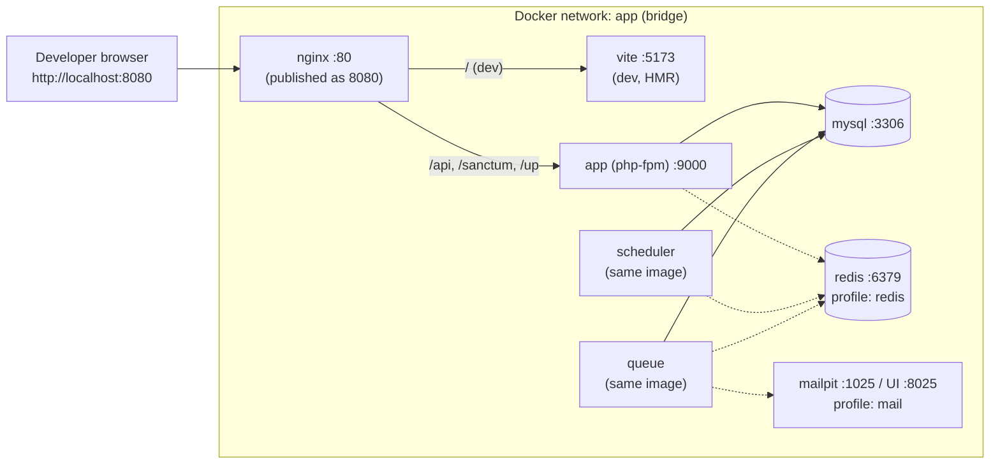

# Docker architecture: local development — Phase 05

**Status:** PROPOSED. This is a design only: **no `docker-compose.yml`, Dockerfile or `.env` is created in this phase.**
- **Stack constraint:** Docker, Nginx, PHP-FPM (Laravel 13, PHP 8.3+), MySQL 8 and React 19 (Vite).
- **Host:** the developer machine is Windows 11 (§8).

## 1. Services
| Service | Image basis | Responsibility | Justification | Class |
|---|---|---|---|---|
| `nginx` | Official Nginx | **Single origin** on `http://localhost:8080`. Proxies `/api/*`, `/sanctum/*` and `/up` to `app` via FastCGI. In dev it proxies `/` to `vite`, including the HMR websocket. In production-like mode it serves the built SPA. Sets security headers | Same-origin cookies and CSRF (ADR-003); header hardening (NFR-SEC-04) | CONFIRMED (stack) |
| `app` | PHP 8.3+ FPM with the required extensions (pdo_mysql, intl, bcmath, opcache; redis optional) | Laravel API | Stack | CONFIRMED (stack) |
| `scheduler` | **Same image as `app`** | Runs the Laravel scheduler (`schedule:work`): reservation expiry sweep, campaign boundary events, stats pruning | Needed by `cart:release-expired` (FR-CRT-08, PROPOSED pending PO) and `sales:emit-boundaries` (cache invalidation). Campaign *state* doesn't depend on it (it's derived, ADR-009) | PROPOSED |
| `queue` | **Same image as `app`** | `queue:work` for async listeners and jobs: e-mail sending, search-text rebuild, popularity stats | E-mails shouldn't block requests (PROPOSED auth flows). Listeners are retryable | PROPOSED |
| `mysql` | Official MySQL 8.x | Database: InnoDB, `utf8mb4_0900_ai_ci`, UTC | Stack | CONFIRMED (stack) |
| `vite` (dev only) | Official Node LTS | Vite dev server with HMR for the React app; runs front-end tests | React tooling (frontend-architecture §2) | PROPOSED |
| `redis` (optional, compose profile `redis`) | Official Redis | Optional driver for sessions, cache, queue and atomic locks | **Not required:** the database drivers suffice functionally. Enable it to rehearse the production driver choice once Q-72 / Q-42 decide | PROPOSED, optional |
| `mailpit` (dev only, profile `mail`) | Mail catcher | Captures verification and password-reset e-mails locally; web UI on port 8025 | Lets developers test the PROPOSED e-mail flows without a real provider | PROPOSED, optional |

**Not included:**
- A separate search engine: MySQL FULLTEXT is used (ADR-008).
- A Node container in production: the SPA build is served by Nginx.
- Anything for checkout or payment (M21).

## 2. Container diagram

## 3. Networking
- **Network:** one user-defined bridge network, `app`. Services reach each other by service name (`mysql`, `redis`, `mailpit`, `app`, `vite`).
- **Published ports** (bound to `127.0.0.1` only):
  - `8080` → nginx, the only application entry point
  - `3306` → mysql (optional, for local DB tools)
  - `8025` → the mailpit UI (profile `mail`)
- **Not published:** `app` (PHP-FPM) and `vite` are reachable only through nginx. This keeps the same-origin model identical in dev and production.
- **Sanctum stateful domain** in dev: `localhost:8080`.

## 4. Persistent volumes
| Volume | Type | Mounted in | Purpose |
|---|---|---|---|
| `mysql-data` | named | mysql | Database files survive restarts |
| `redis-data` | named (optional) | redis | Optional persistence (AOF) |
| `./backend` | bind mount | app, scheduler, queue | Live code editing |
| `vendor` | named | app, scheduler, queue (over `./backend/vendor`) | Faster on Windows; isolates Composer dependencies |
| `./frontend` | bind mount | vite | Live code editing |
| `node_modules` | named | vite (over `./frontend/node_modules`) | Faster; avoids platform-specific binaries crossing the host boundary |
| `./backend/storage` | part of the bind mount | app, queue | Logs, uploaded product images (local disk driver) |

## 5. Environment variable categories
Values are never committed. An `.env.example` with **placeholders** will be written in the implementation phase. Secrets in shared environments come from the hosting platform's secret store.

| Category | Examples (names only) | Notes |
|---|---|---|
| Application | `APP_ENV`, `APP_KEY`, `APP_URL`, `APP_DEBUG`, `APP_TIMEZONE` (= UTC) | `APP_DEBUG` off outside local |
| Database | `DB_HOST`, `DB_PORT`, `DB_DATABASE`, `DB_USERNAME`, `DB_PASSWORD` | Separate MySQL users for app and migrations (PROPOSED) |
| Session and auth | `SESSION_DRIVER`, `SESSION_LIFETIME`, `SESSION_SECURE_COOKIE`, `SESSION_SAME_SITE`, `SANCTUM_STATEFUL_DOMAINS` | Session lifetime is a PO decision (authentication-design §4) |
| Cache, queue, locks | `CACHE_STORE`, `QUEUE_CONNECTION`, `REDIS_HOST` | `database` baseline, `redis` optional |
| Mail | `MAIL_MAILER`, `MAIL_HOST`, `MAIL_PORT`, `MAIL_FROM_ADDRESS` | Mailpit in dev |
| Storefront policy | `STOREFRONT_RESERVATION_MINUTES`, `STOREFRONT_RETURN_PERIOD_DAYS`, `STOREFRONT_LOW_STOCK_THRESHOLD`, `STOREFRONT_DISPLAY_TIMEZONE`, `STOREFRONT_CATALOG_ACCESS`, … (system-overview §7) | **PO decisions.** Dev uses clearly labelled placeholders. Production fails closed when any is unset |
| Feature switches | `FEATURE_ENFORCE_LIVE_WINDOW_ON_ADD`, `FEATURE_RELEASE_EXPIRED_RESERVATIONS`, `FEATURE_HIDE_ADD_BUTTON_AFTER_ADD`, `FEATURE_LAST_HOURS_BADGE` | One per HYPOTHESIS behaviour (backend §12) |
| Logging and observability | `LOG_CHANNEL`, `LOG_LEVEL` | Structured JSON logs |
| Front end (build time) | `VITE_API_BASE` (= `/api/v1`) | No secrets in front-end variables: anything `VITE_*` is public |

## 6. Health checks
| Service | Check | Interval / start period (PROPOSED) |
|---|---|---|
| mysql | `mysqladmin ping` against the local socket | 10 s / 30 s |
| app | FastCGI ping of PHP-FPM's status/ping path, or `php artisan` boot via the framework health route `/up` (verify its availability in Laravel 13) | 15 s / 20 s |
| nginx | HTTP GET `/up` through the proxy, which proves nginx → app → DB | 15 s / 20 s |
| scheduler | Heartbeat: a scheduled task touches a timestamp every minute; the check fails if it's older than 3 minutes | 60 s / 60 s |
| queue | Process liveness (worker PID). `queue:work` is restarted with `--max-time` to limit memory growth | 30 s / 20 s |
| redis (optional) | `redis-cli ping` | 10 s / 10 s |
| vite (dev) | HTTP GET on the dev-server port | 30 s / 30 s |

**Start order:** `app`, `scheduler` and `queue` wait until `mysql` is healthy (`depends_on: condition: service_healthy`). `nginx` waits for `app`.

## 7. Local development workflow
1. **Get the code:** clone the repository (monorepo: `backend/`, `frontend/`, `docker/`, `docs/`).
2. **Configure:** copy `.env.example` → `.env` and fill the dev placeholders.
3. **Start:** `docker compose up -d`. Add `--profile mail` and/or `--profile redis` as needed.
4. **Install back-end dependencies** inside `app`: `composer install`, then `php artisan key:generate`.
5. **Prepare the database:** `php artisan migrate --seed`. The seeders create **synthetic** demo data: brands, campaigns, landings and stock. No data from the reference platform is used.
6. **Install front-end dependencies** inside `vite`: `npm install`. The dev server then starts automatically.
7. **Open the app:** `http://localhost:8080`. Mail is at `http://localhost:8025` (profile `mail`).
8. **Run tests:**
   - `php artisan test` in `app` (feature, unit and architecture tests)
   - `npm test` in `vite`
   - Playwright end-to-end tests against nginx
9. **Time travel for lifecycle tests:** use the request clock in tests (ADR-009). Never change the container clocks.

## 8. Windows 11 notes
- **Docker backend:** use Docker Desktop with the **WSL 2** backend, and keep the repository **inside the WSL filesystem** (e.g. `~/projects/...`). Bind mounts from `C:\` are much slower and can break file watching.
- **File watching:** if the repo has to stay on `C:\`, enable polling in Vite's file watcher (slower, but reliable).
- **Line endings:** commit a `.gitattributes` that forces `eol=lf` for shell scripts, Dockerfiles, `*.conf` and PHP/JS sources. Otherwise CRLF line endings break shell entrypoints inside the Linux containers. Set `core.autocrlf=input` (or `false`) for this repository.
- **Ports:** bind published ports to `127.0.0.1`, so the dev database isn't exposed on the LAN.
- **Performance:** the named `vendor` and `node_modules` volumes (§4) avoid the slowest cross-filesystem paths.

## 9. Production-like differences (for later phases)
- **No `vite` container:** the SPA is built in a CI stage, and the static assets are copied into the nginx image.
- **TLS** is terminated at nginx or an upstream load balancer. Then `SESSION_SECURE_COOKIE=true` and HSTS are enabled.
- **`app`, `scheduler` and `queue`:** they use one immutable image with OPcache and no bind mounts.
- **Scheduler:** exactly **one** scheduler instance per environment, or the scheduler's single-server locking (which requires a shared cache store, i.e. the database or Redis).
