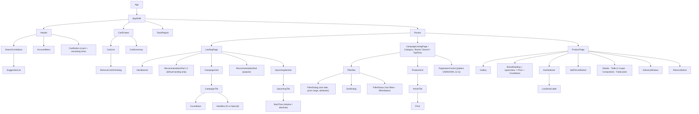

# React frontend architecture — Phase 05

**Status:** PROPOSED, unless a row says CONFIRMED.
- **Stack:** React 19, ES202x, Tailwind CSS, Redux Toolkit / RTK Query (constraint; RTK Query is evaluated in §7).
- **Version check:** library APIs (React Router, RTK Query, Vite) are described at the level of their long-standing features. **Verify them against the current documentation at implementation time.**
- **No code:** this document contains no implementation code.
- **Branding:** neutral. No reference fonts, logos, colours or design-system names are used (C-17, Q-75).

## 1. Principles
1. **Feature-based organisation** (ADR-002). Each feature folder owns its pages, components, API endpoints and tests. `shared/` holds only generic UI and utilities.
2. **Server state lives in the RTK Query cache. The URL holds navigational state** (filters, sort, page). Redux slices hold only a small amount of global UI state.
3. **The server is authoritative.** The client never computes prices, availability or reservation validity. It formats and counts down from server timestamps.
4. **Accessible by construction:** dialogs, alert dialogs, live-region toasts, keyboard-operable menus and a skip link (NFR-A11Y-01).
5. **French only.** Messages come from one catalogue, formatted with `Intl`. There's no i18n library, because one locale doesn't justify one (NFR-I18N-01–03).

## 2. Tooling
| Tool | Choice | Why | Class |
|---|---|---|---|
| Build / dev server | Vite | Fast dev server with HMR and content-hashed production assets (NFR-CACHE-01). Phase 03 found no build-tool marker on the reference, and nothing is copied | PROPOSED |
| Router | React Router (data router, lazy routes) | Nested layouts match the page families; route-level code splitting | PROPOSED |
| State and data | Redux Toolkit + RTK Query | §7 | PROPOSED (evaluated) |
| Styling | Tailwind CSS, with design tokens in the Tailwind theme | Constraint; tokens keep the neutral brand swappable | CONFIRMED (stack) |
| Tests | Vitest + Testing Library; Playwright for end-to-end acceptance criteria | Fits Vite; Playwright checks the observable AC copy | PROPOSED |
| Lint / format | ESLint (incl. jsx-a11y), Prettier | Supports the accessibility requirement | PROPOSED |

## 3. Routes and pages
The route shapes follow the Phase 04 acceptance criteria (system-overview §9).
- **Auth "member":** depends on `catalog_access` (Q-71). In `members` mode, every non-auth route requires a session. In `public` mode, only the cart and account do.

| Route | Page | Layout | Auth | Requirements |
|---|---|---|---|---|
| `/` → redirect to `/event` | — | — | — | FR-NAV-01 |
| `/event` | `LandingPage` (default landing) | `StorefrontLayout` + main nav | member* | FR-EVT-01, FR-REC-01, FR-UPC-01 |
| `/event/:landingId` | `LandingPage` | `StorefrontLayout` + main nav (the curated type hides the upcoming section and footer, FR-EVT-05) | member* | FR-EVT-01–05, FR-NAV-03 |
| `/campaigns/:campaignId` | `CampaignListingPage` | `StorefrontLayout` (no main nav, FR-NAV-03) | member* | FR-CMP-01, FR-CAT-01–09 |
| `/campaigns/top-picks/articles` | `TopPicksListingPage` (declared **before** `:campaignId`) | `StorefrontLayout` | member | FR-REC-01, FR-CAT-01 |
| `/campaigns/:campaignId/articles/:sku` | `ProductPage` | `StorefrontLayout` | member* | FR-PDP-01–08, FR-CMP-06 |
| `/articles/categories/:categoryId` | `CategoryListingPage` | `StorefrontLayout` | member* | FR-CAT-01, FR-CAT-04 |
| `/brands/:brandCode` | `BrandListingPage` | `StorefrontLayout` | member* | FR-BRD-01, FR-BRD-02 |
| `/search-catalog?query=` | `SearchResultsPage` | `StorefrontLayout` | member* | FR-SRC-02 |
| `/help`, `/help/:category`, `/help/:category/:slug` | `HelpPages` | `StorefrontLayout` | public | FR-CNT-02, FR-DLV-01 |
| `/terms`, `/legal/:slug` | `ContentPage` | `StorefrontLayout` | public | FR-CNT-03 |
| `/login`, `/register`, `/forgot-password`, `/reset-password/:token`, `/verify-email` | Auth pages | `AuthLayout` | guest only | FR-ACC-08 |
| `/myaccount` → `/myaccount/overview` | `AccountOverviewPage` | `AccountLayout` | member | FR-ACC-01, FR-ACC-02 |
| `/myaccount/orders` | `OrdersPage` (empty state only; data owned by checkout, C-04) | `AccountLayout` | member | FR-ACC-03 |
| `/myaccount/returns`, `/myaccount/return/selection` (`?withdrawal=true`) | `ReturnsPage`, `ReturnSelectionPage` (entry only, Q-38) | `AccountLayout` | member | FR-ACC-04 |
| `/myaccount/newsletter` | `NewsletterPage` | `AccountLayout` | member | FR-ACC-05, FR-ACC-06 |
| `/myaccount/filter` | `SavedSizesPage` | `AccountLayout` | member | FR-ACC-07 |
| `/myaccount/personal-details` | `ProfilePage` (first name only, Q-41) | `AccountLayout` | member | FR-ACC-01 |
| `*` | `NotFoundPage` | `StorefrontLayout` | — | — |

- **No cart route:** the cart is a **drawer dialog** without its own URL (FR-CRT-01).
- **Not routed:** "Adresses" (C-02) and the external rewards link (FR-OOS-02).

## 4. Layouts
| Layout | Contains | Requirements |
|---|---|---|
| `AppShell` | Skip link "Aller au contenu principal", `Header` (logo → `/event`, `SearchCombobox`, `AccountMenu`, `CartButton`), `UspBar`, global `ToastRegion` (live region), `CartDrawer` portal | FR-NAV-01, FR-NAV-02, FR-NAV-05, NFR-A11Y-01 |
| `StorefrontLayout` | `AppShell` + `<main id="main">` + `Footer` (legal, help, footnotes, consent link, app links) | FR-CNT-01, FR-CNT-04, FR-CNT-05 |
| `StorefrontLayout` + main nav | adds `MainNav` with `MegaMenu` (event pages only) | FR-NAV-03, FR-NAV-04 |
| `AccountLayout` | `StorefrontLayout` + `AccountNav` | FR-ACC-01 |
| `AuthLayout` | minimal header, form area, footer | FR-ACC-08 |

## 5. Component hierarchy (main pages)


## 6. Feature modules
| Feature | Owns | Key components | API slice endpoints |
|---|---|---|---|
| `storefront` | settings, navigation, server-time offset | `UspBar`, `MainNav`, `MegaMenu`, `Footer` | `getSettings`, `getNavigation` |
| `landing` | landing pages | `HeroBanner`, `CampaignGrid`, `CampaignTile`, `UpcomingSection` | `getLanding`, `getUpcoming` |
| `listing` | every listing context | `FilterBar`, `FilterDialog`, `SortDialog`, `FilterStatus`, `ProductGrid`, `ArticleTile` | `listArticles`, `getFacets` |
| `product` | PDP | `Gallery`, `SizeSelector`, `LowStockLabel`, `AddToCartButton`, `DeliveryWindow`, `ReturnsNotice` | `getArticle` |
| `search` | header search | `SearchCombobox`, `SuggestionList` | `getSuggestions` |
| `brand` | brand page header and breadcrumb | `BrandHeader` | `getBrand` |
| `cart` | drawer and timer | `CartButton`, `CartDrawer`, `CartLine`, `RemoveConfirmDialog`, `CartSummary` | `getCart`, `addItem`, `removeItem` |
| `recommendations` | rails | `RecommendationRail` (hidden when empty) | `getRecommendations` |
| `account` | account pages | `AccountNav`, `NewsletterForm`, `UnsubscribeForm`, `SavedSizesForm`, `ProfileForm` | `getOverview`, `getProfile`, `updateProfile`, `getNewsletter`, `updateNewsletter`, `unsubscribe`, `getSavedSizes`, `saveSizes`, `getUnsubscribeReasons` |
| `auth` | session | `LoginForm`, `RegisterForm`, `PasswordResetForms`, `RequireMember` guard | `getMe`, `login`, `logout`, `register`, `forgotPassword`, `resetPassword` |
| `content` | help and legal | `HelpCategoryList`, `ContentBody` (sanitised HTML) | `getHelpTree`, `getPage` |

**Shared UI (`shared/ui`):**
- `Dialog`, `AlertDialog` (focus trap, Escape, return focus), `Toast`
- `Tabs`, `Accordion`, `CheckboxGroup`, `RadioGroup`, `RangeSlider`, `Skeleton`
- `Countdown`, `Price`, `Breadcrumb`

**Shared lib (`shared/lib`):** `formatMoney`, `formatDate`, `plural`, `useServerNow`, `messages.fr`.

## 7. State management: evaluation and decision
| Option | Pros | Cons |
|---|---|---|
| **Redux Toolkit + RTK Query** | Matches the requested stack. Server cache with **tag-based invalidation**, which suits "adding to the cart invalidates cart and article availability". Request de-duplication, polling, and a single store for the few global UI flags. Devtools | Larger than the alternatives. Endpoint definitions are centralised per API slice. Less flexible infinite-query ergonomics, which matters if Q-11 picks infinite scroll (verify the current version's infinite-query support) |
| TanStack Query + Zustand | Best-in-class server cache and infinite queries; Zustand is tiny for UI state | Two libraries instead of one. It departs from the stated stack preference |
| Plain Redux slices + thunks | Full control | Re-implements caching, de-duplication and invalidation by hand. That's error-prone |
| React context + `fetch` | No dependency | No cache or invalidation; re-renders spread across the tree; doesn't scale beyond a few screens |

**Decision (ADR-006):** RTK Query for **all server state**, and Redux Toolkit slices only for:
- `ui`: cart drawer open, active toast queue
- `clock`: offset between server and client time, from `meta.server_time`

**Not in Redux:**
- **Filters, sort and page:** these live in the **URL query string**, so links can be shared, the back button works, and the RTK Query cache key equals the URL. Whether the reference reflects filters in the URL is UNKNOWN (Q-14); this is a PROPOSED choice for the new app.
- **Form drafts:** these live in component state.

**Tags and invalidation:**

| Mutation | Invalidates |
|---|---|
| `addItem`, `removeItem` | `Cart`, `Article:{sku}` (sizes and availability), `Listing` (tile "Réservé" state) |
| `login`, `logout` | everything (`resetApiState`) |
| `updateNewsletter`, `unsubscribe` | `Newsletter` |
| `saveSizes` | `SavedSizes` |
| `updateProfile` | `Me`, `Profile` |

- **Freshness:** stock and campaign state change with time, not only with our own mutations. `getArticle` and `getCart` refetch on focus and reconnect. While the cart drawer is open, `getCart` polls (PROPOSED interval 30 s, Q-42). No other polling.
- **Boundaries:** countdown expiry triggers a refetch of the affected landing and campaign. Campaign start and end boundaries invalidate `Landing` locally.

## 8. API client architecture
- **One base query:** `fetchBaseQuery` with base URL `/api/v1`, `credentials: 'same-origin'`, and `Accept: application/json`.
  - **CSRF:** `prepareHeaders` reads the `XSRF-TOKEN` cookie and sends it as `X-XSRF-TOKEN` on unsafe methods (NFR-SEC-02).
  - **Request ID:** it sends `X-Request-Id`, the client-generated correlation ID (NFR-OBS-01).
- **CSRF bootstrap:** before login or registration, the client calls `GET /sanctum/csrf-cookie` once. It also does this after a 419.
- **Wrapper `baseQueryWithPolicies`:**
  1. **On `419 csrf_token_mismatch`:** refresh the CSRF cookie and retry once.
  2. **On `401 unauthenticated`:** clear the auth state and redirect to `/login?redirect=<current>`.
  3. **Errors:** normalise problem+json into `{status, code, title, detail, errors}` ([error-format.md](api/error-format.md)).
  4. **Server time:** read `meta.server_time` from every success response and update the `clock` offset.
- **One API slice per feature.** Endpoints are injected into one root API, so tags are shared across features.

## 9. Authentication state
- **Source of truth:** `GET /api/v1/me` (RTK Query, tag `Me`). 200 means a member; 401 means no session. The SPA never stores tokens or credentials in JS-accessible storage; the session cookie is HTTP-only.
- **Guards:**
  - `RequireMember` wraps member routes and redirects to `/login` with a return path.
  - `GuestOnly` wraps auth pages.
  - In `catalog_access = members` mode, the storefront routes are also wrapped by `RequireMember` (Q-71).
- **Logout:** `POST /api/v1/auth/logout`, then `resetApiState`, then navigate to `/login`.

## 10. Loading, empty and error states
| State | Pattern | Observed copy (when known) |
|---|---|---|
| Initial page load | Route-level `Skeleton` (grid, PDP) | — |
| Background refetch | Keep the data; subtle indicator; no layout shift | — |
| Empty cart | Text in the drawer | "Vous n’avez aucun article réservé dans votre panier." (FR-CRT-06) |
| Empty orders / returns / updates | Text + call to action | "Une fois vos commandes passées, vous pouvez les voir et les gérer ici.", "Pas de retours récents", "Vous n'avez pas d'actualisations" (FR-ACC-02–04) |
| Empty listing / no search results | Neutral message | UNKNOWN copy (Q-44) |
| Size missing | Inline alert + toast | "Choisissez une taille" (FR-PDP-02) |
| Add success | Toast | Copy is a PO decision (Q-51) |
| Out of stock on add (409) | Toast + PDP refetch | Copy UNKNOWN (NFR-CON-01) |
| Campaign ended (410) | Page message + link to `/event` | Copy UNKNOWN (Q-17) |
| Unexpected error | Route `ErrorBoundary` with a retry; request ID shown for support | — |

## 11. Forms and validation
- **No form library.** The forms are few and small (login, register, password reset, newsletter, unsubscribe, saved sizes, profile). They use controlled components plus a small `useServerErrors` helper that maps 422 `errors` onto fields.
- **Client checks are for user experience only:** `required`, `type=email`, length. The server is authoritative.
- **"Enregistrer" stays disabled until the form is dirty** (BR-15-07). "Se désabonner" stays disabled until a reason is chosen (FR-ACC-06).
- **Labels and errors:** every field has a `<label>`. Errors are linked with `aria-describedby`, and the first invalid field receives focus on submit.

## 12. Time and countdowns
- **`useServerNow()`** returns `Date.now() + offset`, where the offset comes from `meta.server_time`. Every countdown uses it, so a wrong client clock can't show a wrong remaining time (FR-CMP-02, FR-CRT-02).
- **One ticker:** a single shared 1-second ticker drives all mounted countdowns, rather than one interval per tile.
- **Formats:**
  - **End countdown:** ≥ 1 day remaining shows days, hours and minutes; < 1 day shows hours, minutes and seconds (FR-CMP-02).
  - **Upcoming start:** relative within `upcoming_relative_threshold_minutes`, absolute otherwise (FR-UPC-02, Q-35).
  - **Timezone:** dates are formatted in `display_timezone` (Q-10) with `Intl.DateTimeFormat('fr-FR', {timeZone})`.
- **Accessibility:** a countdown's accessible text updates at most once a minute, so screen readers aren't flooded. The visible seconds are `aria-hidden`.

## 13. Responsive design structure
The reference's responsive behaviour is UNKNOWN (Q-15, NFR-RESP-01). The structure is ready for it, without guessing layouts:
- **Mobile-first Tailwind:** default breakpoints `sm/md/lg/xl`; grid columns are set per breakpoint in one `ProductGrid` and one `CampaignGrid` component.
- **Header and navigation:** the header collapses into a menu button below `lg`. `MegaMenu` becomes an accordion drawer. Hover opening applies only to pointer devices; Enter and click always work (FR-NAV-04).
- **Dialogs:** filter dialogs and the cart drawer are full-screen sheets on small screens.
- **Images:** `srcset`/`sizes` from the API image variants, with lazy loading below the fold.
- **To specify with the PO before UI build:** final breakpoints, column counts and mobile navigation.

## 14. Internationalisation and accessibility details
- **Messages:** `messages.fr` holds every UI string, including ARIA labels (NFR-I18N-01).
- **Plurals:** `Intl.PluralRules('fr-FR')`, e.g. "Plus que 1 disponible" / "Plus que 3 disponibles" (NFR-I18N-02).
- **Formatting:** money via `Intl.NumberFormat('fr-FR', {style:'currency', currency:'EUR'})`, which gives "115,00 €" (NFR-I18N-03).
- **Accessibility patterns:**
  - **Dialogs:** `role="dialog"` with `aria-modal`. The remove confirmation uses `role="alertdialog"` (FR-CRT-04).
  - **Toasts:** a `role="status"`/`alert` region.
  - **Mega-menu:** a disclosure pattern.
  - **Search:** the ARIA combobox pattern.

## 15. Performance
- **Splitting and caching:** route-level code splitting. Assets are content-hashed and served with `immutable` caching; `index.html` isn't cached (NFR-CACHE-01).
- **Images:** tile images are lazy-loaded with explicit dimensions, to avoid layout shift.
- **No third-party scripts before consent** (NFR-PRV-01).

### 15.1 Link-source attribution (FR-ANL-01, Could)
- **The parameter:** product links built by `ArticleTile` append a neutral source parameter (`src=campaign|category|brand|search|top-picks|continue-shopping|popular`), set by the rendering context. The reference's parameter names aren't reused, including its `highligts_carousel` typo.
- **Who reads it:** only the consent-gated analytics integration. The API ignores it, so it never changes responses or cache keys.

## 16. Directory structure
```text
frontend/
├── index.html
├── src/
│   ├── app/            (store, root API slice, router, providers, AppShell)
│   ├── layouts/        (StorefrontLayout, AccountLayout, AuthLayout)
│   ├── features/
│   │   ├── storefront/ {components, api, pages?}
│   │   ├── landing/    {components, pages, api}
│   │   ├── listing/    {components, pages, api, url-state}
│   │   ├── product/    {components, pages, api}
│   │   ├── search/     {components, api}
│   │   ├── brand/      {components, pages, api}
│   │   ├── cart/       {components, api, slice}
│   │   ├── recommendations/ {components, api}
│   │   ├── account/    {components, pages, api}
│   │   ├── auth/       {components, pages, api, guards}
│   │   └── content/    {components, pages, api}
│   ├── shared/
│   │   ├── ui/         (Dialog, AlertDialog, Toast, Tabs, Accordion, Countdown, Price, …)
│   │   ├── lib/        (formatMoney, formatDate, plural, useServerNow, problem-details)
│   │   └── i18n/       (messages.fr)
│   └── styles/         (Tailwind entry, tokens)
└── tests/              (unit and component; e2e under /e2e with Playwright)
```
