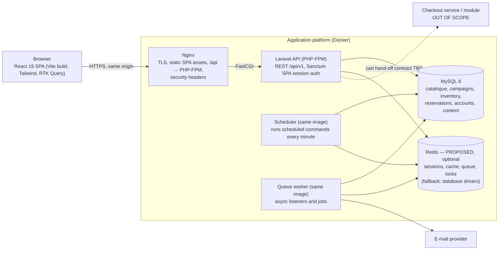
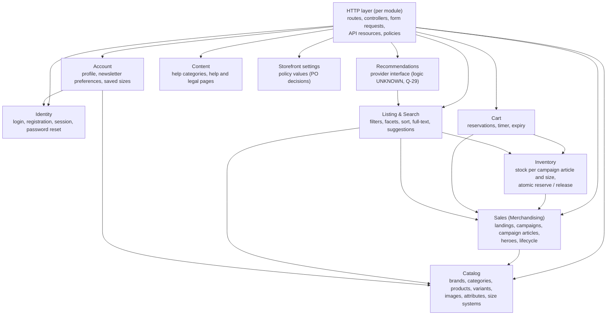
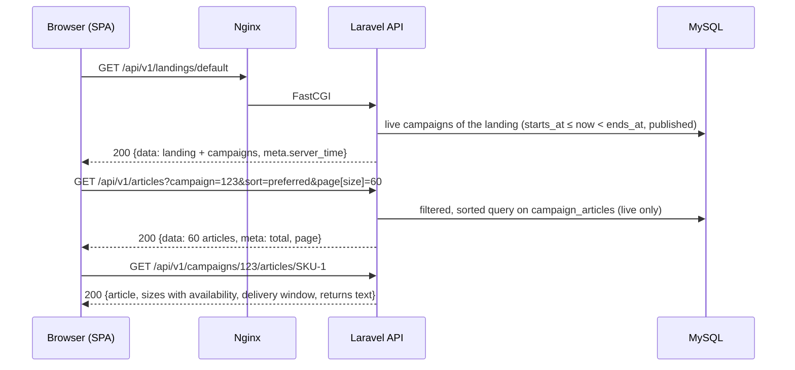
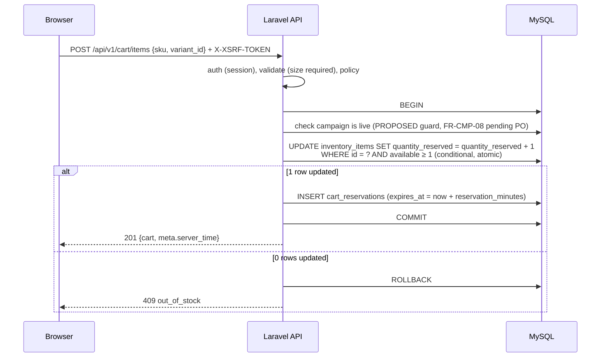

# System overview — Phase 05 (System design & architecture)

**Inputs:**
- Phases 01–04: [`docs/discovery/`](../discovery/), [`docs/modules/`](../modules/), [`docs/technical/`](../technical/), [`docs/requirements/`](../requirements/)
- The requirement IDs (FR-…, NFR-…) are in [SRS.md](../requirements/SRS.md), the rules (BR-…) in [business-rules.md](../requirements/business-rules.md), and the questions (Q-…) in [open-questions.md](../requirements/open-questions.md).

**Stack (constraint set by the user, NFR-TECH-01):**
- Laravel 13 on PHP 8.3+
- React 19 (ES202x)
- MySQL 8
- REST
- Redux Toolkit / RTK Query (to be evaluated)
- Tailwind CSS
- Docker
- Nginx
- Git

**Scope kept from Phase 04:**
- Checkout and payment (M21) are **excluded**. Only the hand-off from the cart is designed, as a boundary.
- Zalando Plus (M16), notify-me behaviour (FR-UPC-04) and the back-office UI aren't designed either.

This is documentation only. No application code, SQL DDL, `docker-compose.yml` or `.env` file is part of Phase 05.

## 1. Decision labels
| Label | Meaning in Phase 05 |
|---|---|
| **CONFIRMED** | Directly required by a CONFIRMED FR/NFR, or by the stack constraint (`CLAUDE.md.txt` plus the Phase 05 brief). |
| **PROPOSED** | An architect's choice with stated tradeoffs. Anything that implements a Phase 04 **HYPOTHESIS** is PROPOSED and flagged **"pending PO validation"**. These are FR-CMP-08, FR-CRT-08, FR-PDP-04, FR-STK-03, FR-UPC-04, FR-EVT-03, FR-EVT-05 and NFR-SEC-05. |
| **UNKNOWN** | Blocked by an open question (Q-ID). The design leaves a seam for it, never a guessed value. |

**Policy values** are shown as named settings with their open question and the value observed on the reference. They are **never silent defaults** (§7). Examples: the return period, fee, reservation length, low-stock threshold and display timezone.

**Version-specific details** of Laravel 13, Sanctum, React 19, React Router, Redux Toolkit and Vite must be **verified against the current documentation at implementation time**. This design relies only on their long-standing, documented capabilities.

## 2. Architecture overview
| Decision | Choice | Class | ADR |
|---|---|---|---|
| Overall style | **Modular monolith**: one Laravel application with explicit domain modules, plus one React SPA | PROPOSED | [ADR-001](adr/ADR-001-modular-laravel-architecture.md) |
| Client–server split | React SPA talks only to a versioned JSON REST API `/api/v1` | CONFIRMED (stack) | — |
| Origin | **One origin.** Nginx serves the SPA build and proxies `/api` and `/sanctum` to PHP-FPM, so there's no CORS and cookie sessions work | PROPOSED (backs NFR-SEC-01, NFR-SEC-04) | [ADR-003](adr/ADR-003-api-authentication-strategy.md) |
| Authentication | Sanctum **SPA (stateful cookie session) + CSRF** | PROPOSED (backs NFR-SEC-01, NFR-SEC-02) | ADR-003 |
| Campaign ↔ product | A campaign sells **campaign articles** (SKU, RRP, sale price) that reference a catalogue product | PROPOSED (backs FR-CMP-06, FR-CMP-07) | [ADR-004](adr/ADR-004-campaign-product-relationship.md) |
| Stock | Inventory per **campaign article × size**, with an atomic reserved counter | PROPOSED (backs FR-STK-01, NFR-CON-01) | [ADR-005](adr/ADR-005-variant-inventory-modeling.md) |
| Front-end state | RTK Query for server state; a few small slices for UI state; filters live in the URL | PROPOSED | [ADR-006](adr/ADR-006-state-management.md) |
| Search | MySQL FULLTEXT and prefix indexes, with no extra search engine in v1 | PROPOSED | [ADR-008](adr/ADR-008-search-mysql-fulltext.md) |
| Time and money | Store UTC and integer cents. Display in a configured timezone (UNKNOWN, Q-10) | PROPOSED | [ADR-009](adr/ADR-009-time-and-money.md) |
| Reservation expiry | Expiry time stored per reservation, filtered on read, plus a scheduled release sweep | PROPOSED, pending PO validation (FR-CRT-08) | [ADR-010](adr/ADR-010-reservation-expiry.md) |
| Runtime | Docker: Nginx, PHP-FPM, scheduler, queue worker, MySQL, Node (dev); Redis optional | PROPOSED | [ADR-007](adr/ADR-007-docker-environment.md) |

**Why a modular monolith:**
- **Team size:** one team is assumed.
- **Domain shape:** campaigns, inventory and cart are tightly coupled through one transactional invariant (no overselling, NFR-CON-01). That's simplest inside one database transaction.
- **Unknown load:** load targets are UNKNOWN (Q-42), so the design can't justify distributed services.
- **Exit path:** each module has its own namespace, routes and events, so it can be extracted later.

## 3. Diagrams
Source files: [diagrams/system-context.mmd](diagrams/system-context.mmd), [diagrams/container-diagram.mmd](diagrams/container-diagram.mmd), [diagrams/component-diagram.mmd](diagrams/component-diagram.mmd). They are reproduced below.

### 3.1 System context
```mermaid
flowchart TB
  member["Member (registered shopper)<br/>CONFIRMED role"]
  guest["Guest<br/>UNKNOWN role (Q-03, Q-28)"]
  merch["Merchandiser / back-office user<br/>HYPOTHESIS role (Q-50)"]
  system["Flash-sale web application<br/>(React SPA + Laravel REST API)"]
  checkout["Checkout & payment<br/>OUT OF SCOPE (M21, Q-04)"]
  mail["Transactional e-mail provider<br/>PROPOSED (verification, password reset)"]
  esp["Newsletter / e-mail marketing tool<br/>UNKNOWN (sending not observed)"]
  cmp["Consent management (CMP)<br/>CONFIRMED need (FR-CNT-04), tool UNKNOWN"]
  analytics["Analytics<br/>PROPOSED, consent-gated (NFR-PRV-01)"]
  member -->|browses, reserves, manages account| system
  guest -.->|access mode UNKNOWN| system
  merch -.->|manages campaigns, catalogue, stock<br/>(interface not specified)| system
  system -->|hand-off from cart (boundary only)| checkout
  system -->|sends account e-mails| mail
  system -.->|exports newsletter preferences| esp
  member -->|sets consent| cmp
  system -.->|events only after consent| analytics
```

### 3.2 Containers


### 3.3 Components (Laravel API)

The module dependencies follow the Phase 02 dependency graph ([dependencies.md](../requirements/dependencies.md)): catalogue first, then sales, inventory, cart, listing and recommendations. Dependencies point one way only, and there are no cycles.

## 4. Front-end and back-end responsibilities
| Concern | Front end (React SPA) | Back end (Laravel API) |
|---|---|---|
| Source of truth | None. Holds a cache of server state | All business state and every invariant |
| Campaign state (upcoming, live, ended) | Renders countdowns from `ends_at` / `starts_at` plus the server-time offset | Derives state from the clock (ADR-009). Only live campaigns appear in grids (FR-EVT-02) |
| Countdown format (FR-CMP-02, FR-UPC-02) | Formats d/h/m vs h/m/s and relative vs absolute | Supplies the timestamps, `meta.server_time` and the upcoming-format threshold (UNKNOWN, Q-35) |
| Reservation timer (FR-CRT-02) | Shows the remaining time from `expires_at` | Sets `expires_at` and enforces it on every read and write |
| Stock and "Plus que N disponibles" (FR-PDP-05) | Renders the label with plural rules (NFR-I18N-02) | Computes availability. Exposes `low_stock_quantity` only at or below the threshold (UNKNOWN, Q-26) |
| Size required (FR-PDP-02) | Blocks the submit and shows "Choisissez une taille" | Validates again (422 `size_required`) |
| Filters and sort (FR-CAT-03–08) | Dialog state; the URL query string is the filter state | Applies filters, sort, facets, counts and pagination |
| Money and dates (NFR-I18N-03) | Formats with `Intl.NumberFormat('fr-FR', EUR)` and `Intl.DateTimeFormat` | Stores and returns integer cents plus ISO-8601 UTC timestamps |
| Authorization | Hides UI the member can't use | Enforces with middleware and policies |
| Consent (NFR-PRV-01) | Loads analytics only after consent | Sends no personal data to third parties from the server |

## 5. Integration boundaries
| Boundary | Direction | Contract | Class |
|---|---|---|---|
| Checkout & payment | Cart → checkout | A hand-off from "Commander" (FR-CRT-07): the checkout module receives the member's active reservations and later reports sold quantities. Defined only as an interface; see [api-contracts.md §10](api/api-contracts.md) | OUT OF SCOPE (Q-04) |
| Orders and returns read model | Checkout → account pages | Account order and return lists (FR-ACC-03, FR-ACC-04) depend on data owned by checkout. Only their empty states are designed | UNKNOWN (Q-04, Q-38) |
| Back-office | Merchandiser → Sales, Catalog, Inventory | Write-side use cases exist as services; no admin UI or admin API is designed | UNKNOWN (Q-50) |
| E-mail provider | API → provider | SMTP or API through Laravel Mail for verification and password reset | PROPOSED |
| Newsletter sending | Account → marketing tool | Preferences are stored. The export/sync mechanism is UNKNOWN | UNKNOWN |
| Consent management | Browser ↔ CMP | The footer opens the consent settings (FR-CNT-04). Tool choice: PO | UNKNOWN (tool) |
| Analytics | Browser → analytics | Consent-gated, with no personal attributes by default (NFR-PRV-01) | PROPOSED |
| Notify-me | — | Not designed (FR-UPC-04 HYPOTHESIS, Q-47) | OUT OF SCOPE |

## 6. Data flow

### 6.1 Browse → listing → product (J1)


### 6.2 Reserve (add to cart), with no overselling (FR-PDP-03, FR-CRT-02, NFR-CON-01)


### 6.3 Release (remove, or expiry)
- **Remove:** `DELETE /api/v1/cart/items/{id}`, after the UI confirmation (FR-CRT-04). One transaction deletes the reservation and decrements `quantity_reserved`.
- **Expiry** (PROPOSED, pending PO validation, FR-CRT-08):
  - **On read:** reads ignore reservations past `expires_at`.
  - **Sweep:** a scheduled command runs every minute and releases them in batches.
  - Both paths use the same release service (ADR-010).

## 7. Policy values (PO decisions, never silent defaults)
They sit in one configuration source (`config/storefront.php`, read from the environment). The SPA reads them from `GET /api/v1/storefront/settings`. Each one is UNKNOWN until the PO sets it.

| Setting | Used by | Open question | Reference observation (input only) |
|---|---|---|---|
| `reservation_minutes` | FR-CRT-02 | Q-25 (PO), Q-32 | 20 |
| `reservation_timer_mode` (per item / shared) | FR-CRT-02 | Q-32 | UNKNOWN |
| `max_quantity_per_article` | FR-PDP-04 | Q-46 | Effectively 1 (the add button disappears) |
| `low_stock_threshold` | FR-PDP-05 | Q-26 | N = 3 and 1 seen |
| `return_period_days` | FR-PDP-07, FR-DLV-02 | Q-31 | 30 / 31 / 14 (conflict) |
| `packaging_fee_cents` (display only) | FR-PRC-02 | Q-30 (PO) | 390 per order |
| `display_timezone` | NFR-TIME-01 | Q-10 | UNKNOWN (maybe the browser's) |
| `upcoming_relative_threshold_minutes` | FR-UPC-02 | Q-35 | between 84 and 780 |
| `upcoming_horizon_hours` (how far ahead "Prochainement" looks) | FR-UPC-01 | Q-74 | about 1 day seen |
| `last_hours_badge_threshold_hours` | FR-STK-03 (HYPOTHESIS) | Q-36 | UNKNOWN |
| `listing_page_size` | FR-CAT-09 | — | 60 (BR-06-07, CONFIRMED) |
| `catalog_access` (`members` / `public`) | all catalogue routes | Q-28, Q-71 | Help text says membership is required |

## 8. Domain model (Task 2)
Full entity definitions are in [database/erd.md](database/erd.md) and the tables in [database/schema.md](database/schema.md).

### 8.1 Evaluation of the candidate entities from the brief
| Candidate | Verdict | Reason | Requirement / evidence |
|---|---|---|---|
| User | **Include** (`users`) | Member identity, one account per customer, 18+ | FR-ACC-08, NFR-SEC-01 |
| CustomerProfile | **Merge into User** | The only profile field observed is a greeting name. The personal-details form wasn't opened (Q-41), and a 1:1 table without fields isn't justified | FR-ACC-02, Q-41 |
| Brand | **Include** | Brand code and name, brand pages and suggestions | FR-BRD-01, FR-BRD-02, FR-SRC-01 |
| Category | **Include** (tree) | Mega-menu columns and category listings | FR-NAV-04, FR-CAT-04 |
| Product | **Include** | The model: brand, type, colour, details, composition, images | FR-PDP-01 |
| ProductVariant | **Include, as product × size** | Sizes in a size system, selected on the PDP | FR-PDP-02, FR-PDP-08, FR-CAT-06 |
| ProductImage | **Include** | Gallery tabs, two tile images, alt text for accessibility | FR-PDP-01, FR-CAT-02, NFR-A11Y-01 |
| Campaign | **Include** | Time-boxed sale with headline and image | FR-CMP-01–10 |
| CampaignProduct | **Include, as `campaign_articles`** | The sellable article: SKU, RRP and sale price inside a campaign | FR-CMP-06, FR-CMP-07, FR-PRC-01 |
| Inventory | **Include** (`inventory_items`) | Limited stock per article and size; reserved units unavailable to others | FR-STK-01, FR-STK-02, NFR-CON-01 |
| Wishlist | **Exclude** | No wishlist was observed in any capture. The only match ("Vos looks favoris") is a campaign name (`a11y/home_desktop`). Adding it would be an unconfirmed feature | — (C-01) |
| WishlistItem | **Exclude** | As Wishlist | — (C-01) |
| Cart | **Exclude as a table** | The cart has no attributes of its own; it's the member's set of active reservations | FR-CRT-01–06 (ADR-010) |
| CartItem | **Include, as `cart_reservations`** | A reserved unit with `expires_at` | FR-CRT-02, FR-CRT-03, FR-CRT-04 |
| NotificationPreference | **Include, as `newsletter_preferences`** | Daily and weekly sales e-mails, personalisation opt-in, unsubscribe reason | FR-ACC-05, FR-ACC-06 |
| Recommendation | **Exclude as an entity; a service boundary** | Recommendation logic is UNKNOWN (Q-29). Only the rail display is CONFIRMED. One supporting table serves the "popular" rail (§8.2) | FR-REC-01, FR-REC-02 |
| Address | **Exclude** | Only an account-nav link was seen; the form was never opened (Q-41). Its consumer, delivery at checkout, is OUT OF SCOPE | Q-41, M21 (C-02) |

### 8.2 Entities added, each with a justification
| Entity | Why | Requirement |
|---|---|---|
| Landing (domain term "event landing") | Numeric landings, a live-campaign grid, a hero, a mega-menu root. The model is named `Landing` because "Event" clashes with Laravel events | FR-EVT-01–05, FR-NAV-03 |
| LandingCampaign (pivot) | Many-to-many with an order | FR-EVT-02, FR-EVT-03 |
| SizeSystem, SizeValue | Size tabs in filters, EU/US in saved sizes, one list of valid size labels per system | FR-CAT-06, FR-ACC-07, FR-PDP-08 |
| GarmentGroup | Groups for saved sizes (Chaussures, Hauts / Tops…) | FR-ACC-07 |
| SavedSizePreference | A member's saved sizes | FR-ACC-07 |
| Attribute / AttributeValue / ProductAttributeValue | Context-dependent filters (Couleur, Composition, Longueur) and PDP details | FR-CAT-04, FR-PDP-01 |
| UnsubscribeReason | Unsubscribing requires a reason. The list values are UNKNOWN | FR-ACC-06 |
| HelpCategory, ContentPage | Help articles at `/help/<category>/<slug>`, terms and legal pages | FR-CNT-02, FR-CNT-03, FR-DLV-01 |
| ArticlePopularity | A rolling reservation count for the "popular" rail. A PROPOSED v1 strategy, pending Q-29 | FR-REC-02 |

## 9. Route alignment with the Phase 04 acceptance criteria
The front-end route shapes **adopt** the patterns that Phase 04 acceptance criteria name, so no acceptance criterion needs amending:
- `/event/{id}`
- `/campaigns/{campaignId}`
- `/campaigns/{campaignId}/articles/{sku}`
- `/articles/categories/{id}`
- `/brands/{code}`
- `/search-catalog?query=`
- `/campaigns/top-picks/articles`
- `/help/<category>/<slug>`
- `/myaccount/…`

These are generic URL shapes, not protected assets. The PO may still rename them (Q-75, together with naming and branding). The API uses its own resource names under `/api/v1` (e.g. `landings`), because API routes aren't fixed by any acceptance criterion.

## 10. Contradictions and gaps register
These were found while reading Phases 01–04 and the Phase 05 brief. **None is silently resolved.** Each one is repeated in [design-validation.md](design-validation.md).

| ID | Contradiction or gap | Handling in this design | Class | Question |
|---|---|---|---|---|
| C-01 | The brief lists Wishlist/WishlistItem and `/api/v1/wishlist`, but no wishlist was observed | Not designed. It can be added as a module later if the PO wants it | UNKNOWN | Q-76 |
| C-02 | The brief lists Address "only if required by confirmed scope". Only the nav link is confirmed, and its consumer is checkout (excluded) | Not designed | UNKNOWN | Q-41, Q-04 |
| C-03 | Three return periods are published on the reference (30 / 31 / 14 days) | One setting, `return_period_days`, used everywhere. Its value is UNKNOWN | UNKNOWN | Q-31 |
| C-04 | Account "Commandes" and "Retours" pages (FR-ACC-03, FR-ACC-04) need order data owned by checkout (excluded) | Empty states and a read-model boundary only | UNKNOWN | Q-04, Q-38 |
| C-05 | Guest access: the help text says membership is required, but the guest experience was never observed | `catalog_access` setting with the `members` mode first; `public` mode supported | UNKNOWN | Q-28, Q-71 |
| C-06 | Reference SKU granularity: one *model code* under two campaigns with *different SKU suffixes* (possibly colours). An identical sellable item in two campaigns was never seen | The schema *allows* one product in several campaigns at different prices (ADR-004). Whether a product means model or model + colour is open | PROPOSED | Q-70 |
| C-07 | Per-campaign stock allocation is a HYPOTHESIS (PRD §2.2), but no-overselling needs *some* stock scope | Stock is scoped to campaign article × size (ADR-005) | PROPOSED | Q-70 |
| C-08 | Reservation expiry (FR-CRT-08) and "can't add after campaign end" (FR-CMP-08) are HYPOTHESIS, yet a 20-minute timer means nothing without expiry | Both designed and flagged "pending PO validation". Each one is a single guard or service that can be switched off | PROPOSED | Q-37, Q-17 |
| C-09 | The display timezone is unknown; the reference may render in the browser's timezone | Store UTC. Display in `display_timezone` (setting) | UNKNOWN | Q-10 |
| C-10 | Recommendations are CONFIRMED as UI, but their logic is UNKNOWN, and "Populaire dans votre région" implies a region the app doesn't have | Provider interface. "For you" and "continue shopping" return empty, and the UI hides them. "Popular" uses the PROPOSED reservation-count strategy, with no regional dimension | UNKNOWN | Q-29, Q-78 |
| C-11 | Phase 03 found the reference uses GraphQL alongside REST. The brief mandates REST | REST only. The reference transport isn't relevant to an independent design | CONFIRMED (stack) | — |
| C-12 | Performance targets are UNKNOWN, so they can't justify Redis or extra containers | Redis is optional, with database drivers as the baseline; the upgrade path is documented | PROPOSED | Q-42, Q-72 |
| C-13 | How listings go past the first 60 products (infinite scroll or a control) is UNKNOWN | The API supports page-based pagination with a total. The UI pattern stays open | UNKNOWN | Q-11 |
| C-14 | The "Préférés" sort meaning is UNKNOWN | Implemented as merchandising position, then newest, as a placeholder | UNKNOWN | Q-43 |
| C-15 | The discount % rounding rule is unknown (only an exact case was seen: 115 vs 250 = 54 %) | Computed with one documented rule, a PROPOSED floor, so the headline never overstates. Flagged for the PO | UNKNOWN | Q-77 |
| C-16 | Back-office use cases (create campaigns, assign stock) are needed for any data to exist, but were never specified | Domain services exist. Data enters through seeders and imports in v1; there's no admin UI | UNKNOWN | Q-50 |
| C-17 | The product name and brand identity are undefined. Reference branding must not be used | Neutral naming. No reference fonts, logos or design-system names | UNKNOWN | Q-75 |

## 11. Document map
| Document | Content |
|---|---|
| [database/erd.md](database/erd.md) | Entity definitions (purpose, attributes, relationships, constraints, lifecycle, source) and the ER diagram |
| [database/schema.md](database/schema.md) | MySQL tables, columns, keys, constraints, normalisation notes |
| [database/indexing-strategy.md](database/indexing-strategy.md) | Indexes per access path, full-text, sort and filter support |
| [backend-architecture.md](backend-architecture.md) | Laravel modules, layers, events, jobs, errors, validation, directory structure |
| [frontend-architecture.md](frontend-architecture.md) | Routes, layouts, feature modules, RTK Query, auth state, states, responsive structure |
| [api/api-contracts.md](api/api-contracts.md), [api/error-format.md](api/error-format.md) | REST endpoints and the error format |
| [authentication-design.md](authentication-design.md) | Sanctum SPA sessions, CSRF, policies, roles |
| [docker-architecture.md](docker-architecture.md) | Local environment |
| [adr/](adr/) | ADR-001–ADR-010 |
| [design-validation.md](design-validation.md) | Coverage and consistency checks |
