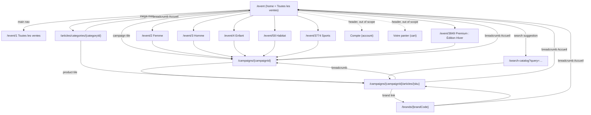

# Phase 01 — Sitemap

**Platform:** `https://www.zalando-prive.fr` · **Captured:** 2026-11-04 · **Evidence index:** [`evidence/INDEX.md`](../../evidence/INDEX.md)
Paths are relative to the origin. `a11y/…` = `evidence/a11y/…`, `shot/…` = `evidence/screenshots/…`.
Campaign IDs (`ZZO4…`) and event content are time-limited and will expire.

## 1. Navigation diagram

## 2. Visited pages (in scope)

| # | Page type | URL pattern (observed example) | Reached from | Observation | Evidence | Confidence | Unknown |
|---|---|---|---|---|---|---|---|
| P1 | Home / all sales | `/event` | Logo, "Privé" header icon, breadcrumb "Accueil" | Campaign grid plus personalized and promo rails | `a11y/home_desktop.yaml`, `shot/home_desktop.png` | CONFIRMED | Phase 02: `/event/1` renders the same 126 campaigns and rails as `/event`, with no redirect (M05 BR-05-02) |
| P2 | Event landing (vertical) | `/event/{eventId}`: 1, 2, 3, 4, 58, 3774, 3849 | Main nav links (client-side routing, no `href`) | Same template: hero banner + "Découvrir", H2 = vertical name, campaign grid, "Populaire dans votre région", and a lazily loaded "Prochainement" (global list) and footer on all except Premium (Phase 02, [M05](../modules/M05.md)) | `evidence/nav-routes.json`, `a11y/page_femme.yaml`, `a11y/page_sports.yaml`, `a11y/page_premium.yaml` | CONFIRMED for all 7 (Phase 02 captures `page_all`, `page_homme_scrolled`, `page_enfant_scrolled`, `page_habitat`) | Meaning of the numeric IDs, and whether more event IDs exist |
| P3 | Category listing (cross-campaign) | `/articles/categories/{id}?category={id}` | Mega-menu links | Breadcrumb, H1 vertical (e.g. "Homme"), filter pills (catégories, Taille, Longueur, Marque, Composition, Couleur, Prix, Tri), "Réinitialiser", 60 product tiles | `a11y/category_80000687_outline.txt` | CONFIRMED | Pagination or infinite-scroll mechanism |
| P4 | Campaign (sale event) | `/campaigns/{campaignId}` (e.g. `/campaigns/ZZO4RN5`) | Campaign tiles, PDP breadcrumb | Breadcrumb, H1 campaign name, filter pills, 4-col product grid (60 tiles in first load), no main nav | `a11y/campaign_desktop.yaml`, `shot/campaign_desktop.png` | CONFIRMED | Campaign countdown on this page not seen in the a11y tree; ended-campaign behaviour |
| P5 | Product detail (PDP) | `/campaigns/{campaignId}/articles/{sku}` (e.g. `…/ZZO4RN5/articles/H1X44A00D-A11`) | Any product tile | Image gallery, brand link, price/RRP, countdown, size radios, "Ajouter au panier", details accordions, Plus block, delivery and returns, "Voir plus" related facets | `a11y/product_desktop.yaml`, `shot/product_desktop.png` | CONFIRMED | Behaviour of the "Ajouter au panier" button (**not clicked**) |
| P6 | Brand listing | `/brands/{brandCode}` (e.g. `/brands/H1X`) | PDP brand link | Breadcrumb, filters, "Vos filtres (5 Articles)", products across campaigns, "Réservé" state | `a11y/brand_H1X.yaml`, `shot/brand_H1X.png` | CONFIRMED | Whether an A-Z brand index page exists (the "A-Z" icon in the USP bar was not followed) |
| P7 | Search results | `/search-catalog?query={q}&searchAnonId={id}` | Search suggestion | 60 product tiles, "Dernières heures" badges | `a11y/search_results.yaml` | CONFIRMED | Free-text submit behaviour (only a suggestion was selected) |
| P8 | Search overlay (not a page) | on `/event` | Header combobox | Brand suggestions listbox (e.g. "Nike", "Nike Sportswear"…), "Close search" | `a11y/search_suggest.yaml`, `shot/search_suggest.png` | CONFIRMED | Suggestion types other than brands |

### Product-link tracking parameters (observed)
Product URLs carry `navigationSource` and `catalog-type`, which identify the referring module:

| navigationSource | catalog-type | Origin module | Evidence |
|---|---|---|---|
| `catalog` | `campaign` | Campaign grid | `a11y/campaign_desktop.yaml` |
| `ccf` | `cross-campaign` / `brand` | Category listing / brand page | `ev_1de6607a8e1309dd…` DOM URLs (category), `a11y/brand_H1X.yaml` (brand) |
| `tp4u` | `top-picks` | "Recommandé pour vous" | `a11y/home_desktop.yaml` |
| `continue_shopping` | `campaign` | "Continuez votre shopping" | `a11y/home_desktop.yaml` |
| `highligts_carousel` (sic) | — | "Populaire dans votre région" | `a11y/home_desktop.yaml` |
| `search_catalog` | `search` | Search results | `a11y/search_results.yaml` |

Confidence: CONFIRMED (values observed). Their analytics or ranking use: HYPOTHESIS. Unknown: what `ccf` stands for, and whether these parameters change ranking or pricing.

Also observed: `/campaigns/top-picks/articles` ("Voir tout" on the recommendations rail), which is a virtual campaign. CONFIRMED link; page not visited.

## 3. Category tree (mega-menus)

Source: `a11y/menu_femme.yaml`, `menu_homme.yaml`, `menu_enfant.yaml`, `menu_habitat.yaml` (Femme, Enfant, Habitat opened by keyboard Enter on the chevron button; Homme opened by mouse hover after a chevron click). Each menu has 4–5 columns. The first item of each column (bold) is the parent category. All targets use `/articles/categories/{id}`.
Confidence: CONFIRMED. Unknown: deeper levels below these two, and whether IDs are stable over time.

- **Enfant** also exposes "Garçon" and "Fille" toggle buttons above the columns. Which one was active during capture is UNKNOWN. Some category IDs are short (`1877`, `11006`, `14964`), suggesting a legacy or shared taxonomy (HYPOTHESIS).
- **Sports:** the chevron sets `[expanded]`, but no category panel rendered (CONFIRMED in `a11y/menu_sports.yaml` and `shot/menu_sports.png`). The reason is UNKNOWN; HYPOTHESIS: Sports is a curated event with no category menu. Its landing is `/event/3774`.
- **Premium : Édition Hiver** and **Toutes les ventes** have no menu (link only).

### Femme (landing `/event/2`)

- **Vêtements** `/articles/categories/55564534` · Robes `/articles/categories/228814038` · Pantalons `/articles/categories/133628086` · T-shirts et hauts `/articles/categories/77755797` · Vestes et manteaux `/articles/categories/218112538` · Jeans `/articles/categories/480508` · Pulls et gilets `/articles/categories/145117849`
- **Chaussures** `/articles/categories/92288919` · Baskets `/articles/categories/149962223` · Sandales `/articles/categories/61197171` · Bottines `/articles/categories/201553912` · Chaussures de sport `/articles/categories/192089653` · Ballerines `/articles/categories/114480182` · Chaussures basses `/articles/categories/99158797`
- **Accessoires** `/articles/categories/164714731` · Sacs et valises `/articles/categories/186905994` · Bijoux `/articles/categories/109630705` · Chapeaux, bonnets et casquettes `/articles/categories/43056916` · Lunettes de soleil `/articles/categories/194115157` · Portefeuilles et étuis `/articles/categories/55535838` · Montres `/articles/categories/171923894`
- **Équipement** `/articles/categories/180036116` · Divers `/articles/categories/142523468` · Gourdes et boîtes `/articles/categories/120332205` · Accessoires de foot `/articles/categories/53758416` · Équipement de sport et yoga `/articles/categories/62658901` · Lunettes de soleil et de sport `/articles/categories/153564253` · Équipement de natation `/articles/categories/214593992`
- **Beauté** `/articles/categories/144099994` · Soins pour cheveux `/articles/categories/22891157` · Soin de la peau `/articles/categories/217543661` · Soins des dents `/articles/categories/143178101` · Maquillage `/articles/categories/166291257` · Ongles `/articles/categories/204252883`
### Homme (landing `/event/3`)

- **Vêtements** `/articles/categories/80000687` · T-shirts et polos `/articles/categories/168765739` · Pantalons `/articles/categories/91490450` · Pulls et gilets `/articles/categories/186676402` · Vestes et manteaux `/articles/categories/224638028` · Chemises `/articles/categories/102191950` · Jeans `/articles/categories/51388524`
- **Chaussures** `/articles/categories/46319661` · Baskets `/articles/categories/68510924` · Chaussures de sport `/articles/categories/74368050` · Chaussures ouvertes `/articles/categories/157275976` · Derbies `/articles/categories/90702187` · Boots et bottes `/articles/categories/197377902` · Chaussures basses `/articles/categories/112893450`
- **Accessoires** `/articles/categories/178000406` · Bonnets, chapeaux et casquettes `/articles/categories/60623191` · Sacs et valises `/articles/categories/200191669` · Lunettes de soleil `/articles/categories/238153295` · Bijoux `/articles/categories/127196980` · Montres `/articles/categories/149388243` · Portefeuilles et étuis `/articles/categories/151510053`
- **Équipement** `/articles/categories/144319380` · Gourdes et boîtes `/articles/categories/204472269` · Divers `/articles/categories/226663532` · Équipement de foot `/articles/categories/137898480` · Lunettes de soleil et de sport `/articles/categories/188701906` · Yoga et matériel de sport `/articles/categories/26942165` · Accessoires de baignade `/articles/categories/71826535`
- **Soins** `/articles/categories/230041073` · Cheveux `/articles/categories/246433873` · Rasage & Soins de la barbe `/articles/categories/158165146` · Hygiène dentaire `/articles/categories/162676410` · Corps `/articles/categories/50370669`
### Enfant (landing `/event/4`)

- **Vêtements** `/articles/categories/187314637` · T-shirts et hauts `/articles/categories/132139175` · Pantalons et jeans `/articles/categories/237586530` · Vestes et manteaux `/articles/categories/213048329` · Pulls et tricots `/articles/categories/168241729` · Sous-vêtements et pyjamas `/articles/categories/159965605` · Maillots de bain et peignoirs `/articles/categories/202697060`
- **Chaussures** `/articles/categories/49443013` · Baskets `/articles/categories/22798420` · Chaussures ouvertes `/articles/categories/25112283` · Chaussures de sport `/articles/categories/1877` · Bottes `/articles/categories/101786885` · Chaussures premiers pas `/articles/categories/160907358` · Chaussures basses `/articles/categories/122014326`
- **Accessoires** `/articles/categories/235007517` · Bonnets, chapeaux et casquettes `/articles/categories/20170983` · Sacs et sacs à dos `/articles/categories/87324047` · Gants `/articles/categories/11006` · Divers `/articles/categories/14964` · Accessoires pour bébé `/articles/categories/92587171` · Foulards et écharpes `/articles/categories/155167244`
- **Jouets et peluches** `/articles/categories/17310563`
### Habitat (landing `/event/58`)

- **Habitat** `/articles/categories/3393068` · Accessoires de cuisine `/articles/categories/168941685` · Vaisselle et couverts `/articles/categories/25584331` · Lampes `/articles/categories/146953977` · Divers `/articles/categories/243216361` · Accessoires de salle de bain `/articles/categories/264331192` · Entretien et hygiène `/articles/categories/176642572`
- **Accessoires de maison** `/articles/categories/211518093` · Accessoires et décoration `/articles/categories/69293476` · Décoration murale `/articles/categories/205703713` · Rangement `/articles/categories/265407624` · Bougies et parfums d'ambiance `/articles/categories/57985370` · Vases `/articles/categories/213527766` · Fleurs et accessoires `/articles/categories/183512450`
- **Linge de maison** `/articles/categories/125050883` · Linge de salle de bain `/articles/categories/231726598` · Linge de lit `/articles/categories/68686870` · Linge de table `/articles/categories/186852348` · Coussins et housses `/articles/categories/219745111` · Tapis et paillassons `/articles/categories/35794107` · Couvertures et plaids `/articles/categories/197553848`
- **Mobilier** `/articles/categories/66135235` · Balcon et jardin `/articles/categories/41066525` · Penderies `/articles/categories/110517761` · Étagères `/articles/categories/132709024` · Tables `/articles/categories/199282813` · Sièges `/articles/categories/177091550` · Divers `/articles/categories/150619687`

## 4. Footer and information pages (discovered links, not visited)

| Group | Link | Target |
|---|---|---|
| Privé by Zalando | À propos · Mentions légales · Protection des données · CGV | `/aboutus/` · `/impress/` · `/privacy/` · `/terms/` |
| | Traitement des données | `#uc-central-modal-show` (consent modal) |
| | Rétractation | `/myaccount/return/selection?withdrawal=true` (**account area, out of scope**) |
| | Carrière · Signaler une vulnérabilité · Sécurité du produit | jobs.zalando.com · corporate.zalando.com · zalando.fr/faq |
| Service client | Aide · Guide des tailles | `/help/` · `/sizehelper/` |
| | (delivery partners) | `/help/envoi-et-livraison/` |
| | (RRP explainer) | `/help/comment-fonctionne-zalando-prive/que-signifie-pvc` |
| Groupe Zalando | Zalando · ABOUT YOU | zalando.fr · aboutyou.fr |
| Social | FB · Insta | facebook.com/LoungebyZalando · instagram.com/privebyzalando |
| Apps | Google Play · App Store | app.adjust.com → fallback `/appli-mobile/` |

Evidence: `a11y/campaign_desktop.yaml`, `a11y/brand_H1X.yaml` (contentinfo). Confidence: CONFIRMED (links). Page contents: UNKNOWN (not visited in Phase 01).

## 5. Out of scope — discovered, not visited

| Element | Where | Status |
|---|---|---|
| "Compte" (account menu) | Header button | Not opened. Contents UNKNOWN |
| "Votre panier" (cart) | Header button | Not opened. Contents UNKNOWN |
| `/myaccount/return/selection?withdrawal=true` | Footer | Not visited |
| Checkout and order pages | — | Not reached |
| "Informez moi" (notify me) | Upcoming sales | Not clicked (would change account state) |
| "Activez Plus" / "Peut-être plus tard" | Plus modal, PDP | Not clicked |
| "Ajouter au panier" | PDP | Not clicked |

## Phase 02 additions (authorized 2026-11-04)
| Route | Reached from | Notes | Status |
|---|---|---|---|
| (drawer, no URL) Cart | header "Votre panier" | `dialog`. Reservation timer in its title | CONFIRMED ([M14](../modules/M14.md)) |
| (drawer, no URL) Account menu | header "Compte" | links `/myaccount`, `/help`, `/logout` | CONFIRMED |
| `/myaccount` → `/myaccount/overview` | account menu | redirect | CONFIRMED |
| `/myaccount/orders`, `/myaccount/returns`, `/myaccount/return/selection`, `/myaccount/newsletter`, `/myaccount/filter` | account nav | read-only | CONFIRMED ([M15](../modules/M15.md)) |
| `/myaccount/personal-details`, `/myaccount/addresses` | account nav | **not opened** (PII) | link CONFIRMED |
| `https://www.zalando.fr/plus?context=LOUNGE_MYACCOUNT` | account nav "Vos récompenses" | external (Zalando) | link CONFIRMED |
| `/help/`, `/help/<category>/`, `/help/<category>/<article>/` | footer "Aide" | 9 categories | CONFIRMED ([M18](../modules/M18.md)) |
| `/terms/` | footer "CGV" | version 22.07.2026, PDF on `assets.ctfassets.net` | CONFIRMED |
| `/contact`, `/accessibility-statement/`, `/sizehelper/`, `/aboutus/`, `/impress/`, `/privacy/` | help/CGV secondary nav | not visited | link CONFIRMED |
| `/logout` | account menu | **not clicked** | link CONFIRMED |
