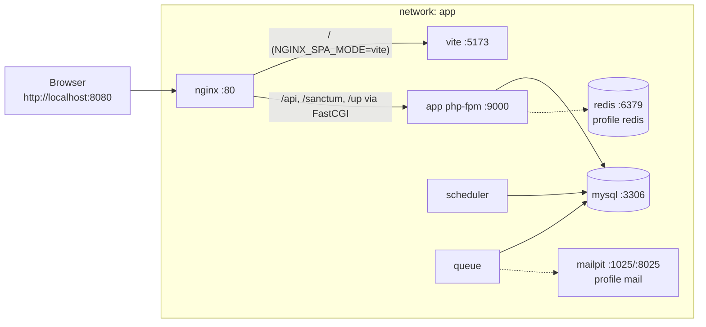

# Docker architecture (as built) — Phase 07

This is the implementation of [docker-architecture.md](../architecture/docker-architecture.md) (Phase 05). Differences from that design are listed in §6.

## 1. Services
| Service | Image | Runs as | Command | Published | Health check |
|---|---|---|---|---|---|
| `nginx` | `nginx:1.30-alpine` (1.30.6) | master root, workers `nginx` | default | `127.0.0.1:${NGINX_PORT:-8080}` → 80 | `wget /up` (nginx → app → MySQL) |
| `app` | `storefront-dev/php:local` (PHP 8.4.27 FPM, Alpine) | `app` (UID/GID 1000) | `php-fpm` | none | FPM `/ping` via `cgi-fcgi`, plus `vendor/autoload.php` present |
| `scheduler` | same image | `app` | `php artisan schedule:work` | none | heartbeat file younger than 3 min |
| `queue` | same image | `app` | `php artisan queue:work --tries=3 --max-time=3600` | none | `pgrep queue:work` |
| `mysql` | `mysql:8.4` (8.4.13) | `mysql` (entrypoint drops root) | utf8mb4, `utf8mb4_0900_ai_ci`, UTC | `127.0.0.1:${MYSQL_FORWARD_PORT:-3306}` | `mysqladmin ping -h 127.0.0.1` |
| `vite` | `storefront-dev/node:local` (Node 24.22.2, Alpine) | `node` (UID 1000) | `npm run dev` | none | `wget :5173` |
| `redis` (profile `redis`) | `redis:8-alpine` | `redis` | `redis-server --appendonly yes` | none | `redis-cli ping` |
| `mailpit` (profile `mail`) | `axllent/mailpit:latest` | image default | default | `127.0.0.1:${MAILPIT_UI_PORT:-8025}` | image's built-in check |

**Restart policy:** `unless-stopped` for every service, so a crashed service restarts until you stop it yourself.

**PHP extensions:** pdo_mysql, intl, bcmath, opcache, pcntl and zip. Composer 2 is bundled. phpredis is installed too, but only used with the `redis` profile.

## 2. Diagram

## 3. Start order and dependencies
1. `mysql` starts first.
2. `app` waits until `mysql` is healthy. On its first start it runs `composer install` into the `vendor` volume, creates `backend/.env` from `.env.example` and generates `APP_KEY`. This happens only when those are missing (`APP_BOOTSTRAP=true` is set on `app` only).
3. `scheduler` and `queue` wait until `app` is healthy, which means dependencies are installed.
4. `vite` runs `npm ci` (or `npm install` without a lock file) into the `node_modules` volume on its first start.
5. `nginx` waits until both `app` and `vite` are healthy.

Upstreams are resolved per request through Docker's DNS (`resolver 127.0.0.11`), so recreating `app` or `vite` doesn't require restarting Nginx. This was verified.

## 4. Nginx routing
| Path | Goes to | Notes |
|---|---|---|
| `/api/*`, `/sanctum/*`, `/up` | Laravel `public/index.php` through FastCGI | `try_files` to the single PHP entry point; the original URI is preserved |
| `/index.php` requested directly | 404 | The entry point is `internal` |
| Any other `*.php` | 404 | No other PHP is executed |
| Hidden paths (`/.env`, `/.git/…`) | 403 | Exceptions: `/.well-known/` and Vite's `/node_modules/.vite/` cache |
| `/` and everything else, `NGINX_SPA_MODE=vite` | `vite:5173`, WebSocket upgrade for HMR | Vite answers unknown paths with `index.html` |
| `/` and everything else, `NGINX_SPA_MODE=static` | `frontend/dist`, `try_files … /index.html` | `index.html` with `no-cache`; `/assets/*` cached for one year, `immutable` |

**Other settings:**
- `autoindex off` (no directory listing).
- `client_max_body_size 20m`, matching PHP's `upload_max_filesize` and `post_max_size`.
- `server_tokens off`; `X-Powered-By` hidden.

## 5. Volumes and networking
- **Named volumes:**
  - `mysql-data`: database files.
  - `vendor`: Composer packages, kept off the slow Windows bind mount.
  - `node_modules`: npm packages; also avoids host platform binaries.
  - `redis-data`: Redis data.
- **Bind mounts:**
  - `./backend` for app, scheduler and queue.
  - `./backend/public` (read-only) for nginx.
  - `./frontend` for vite.
  - `./frontend/dist` (read-only) for nginx.
  - `./docker/nginx/*` (read-only) for nginx.
- **Network:** one bridge network, `app`. Services address each other by name: `mysql`, `app`, `vite`, `redis` and `mailpit`.
- **Published ports:** only on `127.0.0.1`, so nothing is reachable from the LAN.

## 6. Differences from the Phase 05 design
| Phase 05 | As built | Reason |
|---|---|---|
| Workflow step 4: run `composer install` and `key:generate` by hand | The `app` entrypoint does both on first start if they're missing | Fewer manual steps. The entrypoint never overwrites an existing `.env` or `APP_KEY` |
| Workflow step 6: run `npm install` by hand | The `vite` entrypoint runs `npm ci` when `node_modules` is empty | Same reason |
| nginx health check "proves nginx → app → DB" | `/up` gained a database query through `DiagnosingHealth` | Without it, Laravel's `/up` only proves the app boots |
| A single SPA serving mode in dev | Two modes, chosen by `NGINX_SPA_MODE` (`vite` / `static`) | Lets the production-like static serving and the deep-link fallback be tested locally |
| Separate MySQL users for app and migrations (PROPOSED) | One application user | Not needed until migrations exist; left for the CI story (US-058) |
| Queue health check: worker PID | `pgrep -f queue:work` | Same intent |
