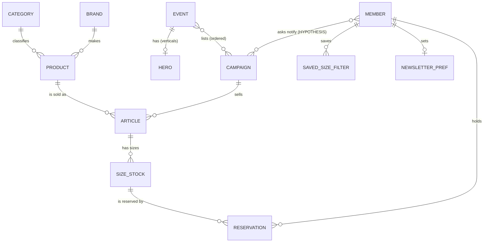
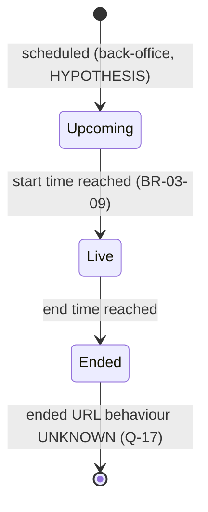
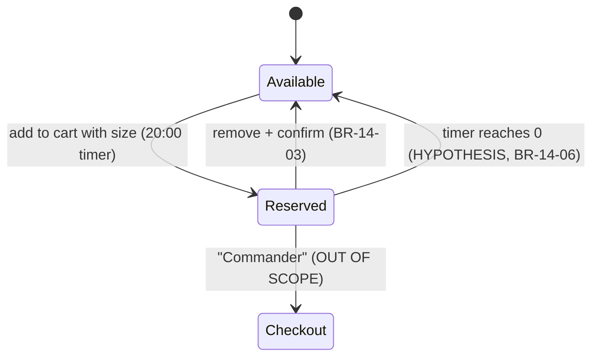

# Product Requirements Document (PRD) — Phase 04

**Product:** an independent members-only flash-sale e-commerce application (Laravel 13 / PHP 8.3+, React 19, MySQL, REST, Docker).
**Basis:** Phases 01–03 of the authorized analysis of zalando-prive.fr (2026-11-04). Nothing in this document comes from outside that evidence. Where the evidence stops, the item is marked UNKNOWN and listed in [open-questions.md](open-questions.md).
**Detail:** the requirements are in [SRS.md](SRS.md), the rules in [business-rules.md](business-rules.md), and the links between them in [traceability-matrix.md](traceability-matrix.md).

Labels: **CONFIRMED / HYPOTHESIS / UNKNOWN / OUT OF SCOPE**, as defined in SRS §1.3.

---

## 1. Purpose
The application sells branded products in **time-limited, deeply discounted sales** to registered members. On the observed day the reference listed 126 live campaigns, and its help text states that about ten new sales launch every day (BR-03-06, BR-03-16). This PRD fixes what the new product must offer to match the observed core experience. It leaves policy values and anything unobserved to the PO.

## 2. Business domain overview

### 2.1 Concept (CONFIRMED)
- **Events:** a **campaign** (a sale) is a named, time-boxed set of articles with a maximum-discount headline. Campaigns are grouped on **event** landings: "all sales" plus verticals Femme, Homme, Enfant, Habitat, Sports and Premium.
- **Campaign states:** a campaign is **upcoming**, then **live**, then **ended**. Only live campaigns are browsable (BR-05-08, BR-03-09).
- **Articles:** products are sold **inside** a campaign (`/campaigns/{campaignId}/articles/{sku}`, BR-03-01). The same model can be sold in several campaigns (BR-03-14).
- **Prices** are discounts vs the RRP, VAT included (BR-12-01, BR-12-02).
- **Stock** is limited and isn't restocked (BR-13-04). Adding to the cart **reserves** a unit for **20 minutes** (BR-14-02).
- **Discovery** runs through landings, category menus, brand search, brand pages and recommendation rails.

### 2.2 Business entities
| Entity | Key attributes (as observed) | Class | Source |
|---|---|---|---|
| Event (landing) | numeric ID, title, hero, campaign order, template | CONFIRMED (display) | M05, BR-05-01 |
| Campaign | ID, name, image, start, end, headline (% or "Special") | CONFIRMED (display) / HYPOTHESIS (stored fields) | M03 |
| Event–Campaign assignment | many-to-many, ordered | CONFIRMED | BR-03-13, BR-05-03 |
| Brand | code, display name | CONFIRMED | M09 |
| Category | numeric ID, tree per vertical | CONFIRMED | M02, sitemap §3 |
| Product (model) | model code, brand, type, colour, attributes, composition | CONFIRMED (display) | M07 |
| Article (SKU) | SKU, campaign, RRP, sale price, images | CONFIRMED | BR-03-01, BR-03-14 |
| Size / stock unit | size in a size system, available quantity | CONFIRMED (display) / HYPOTHESIS (per-campaign allocation) | BR-07-02, BR-06-04 |
| Member | account (one per customer, 18+), preferences | CONFIRMED (rules) / UNKNOWN (profile fields, Q-41) | BR-15-02 |
| Cart reservation | member, article, size, reserved at, expires at | CONFIRMED (behaviour) | BR-14-01–03 |
| Newsletter preference | daily, weekly, personalisation opt-in, unsubscribe reason | CONFIRMED | BR-15-03, BR-15-04 |
| Saved size filter | gender, garment group, size system, sizes | CONFIRMED | BR-15-05 |
| Upcoming-sale subscription | member, campaign | HYPOTHESIS (button only) | M04, Q-47 |
| Order, return | — | OUT OF SCOPE / UNKNOWN (entry pages only) | M15, M21 |
| Help article, legal page | category, slug, body | CONFIRMED | BR-18-02 |
| Hero / banner | event, image, target | CONFIRMED (display) / HYPOTHESIS (target) | BR-11-01, BR-11-02 |

### 2.3 Entity relationships

- **CONFIRMED relationships:** Event↔Campaign is many-to-many, Campaign→Article is campaign-scoped addressing, and Product→Article is one model to several campaigns. Reservations make units unavailable to others.
- **Physical schema:** this is a conceptual model, not the MySQL schema. It's a Phase 05 design task.

### 2.4 Business processes
**P1 Campaign lifecycle.** CONFIRMED transitions. The mechanism and the back-office are HYPOTHESIS.

- **Launch pattern:** about ten launches a day, at 07:00 on weekdays and 08:00 at weekends (Paris). An 18:00 Paris cohort was measured.
- **Duration and end times:** a sale lasts 3–5 days, and end times cluster at a few daily slots (BR-03-07, -08, -10, -16, -18).

**P2 Reservation.** CONFIRMED, except expiry, which is HYPOTHESIS.

**Other processes:**
- **P3 Discovery:** landing → campaign → listing (sort and filter) → PDP. Other routes are category, brand search, brand page and recommendation rails (journeys J1–J7).
- **P4 Account self-service:** newsletter preferences, saved sizes, and the return/withdrawal entry (J9, J11).
- **P5 Checkout:** OUT OF SCOPE (M21).

### 2.5 Module dependencies
[dependencies.md](dependencies.md) shows the module dependencies. The build order it implies is:
1. category and brand
2. product and SKU
3. campaign
4. event
5. listing
6. PDP
7. search
8. upcoming
9. recommendations
10. cart, then checkout under a separate spec

## 3. Actors and personas
Personas are limited to **roles observed or directly implied**. No demographics or goals were invented.

| Persona | Role | Class | Basis | Specified here |
|---|---|---|---|---|
| **P1 Member** | registered shopper: browses, reserves, manages preferences | CONFIRMED | All captures used a member session | Yes |
| **P2 Guest** | visitor without an account | UNKNOWN | Not observed (Q-03). Help says membership is required and free (BR-15-01) | No. PO to decide (Q-28) |
| **P3 Merchandiser** | creates and schedules campaigns, events, heroes and ordering | HYPOTHESIS | Scheduled, curated, ordered content (M03, M05, M11) | Only as the source of campaign data. The back-office needs its own spec (Q-50) |
| **P4 Brand / supplier** | provides assortment | HYPOTHESIS | Brand-named campaigns | No |
| **System (scheduler)** | moves campaigns through states; releases reservations | CONFIRMED (effect) / HYPOTHESIS (mechanism) | BR-03-09, BR-14-06 | Yes (UC-11, UC-12) |

## 4. Goals
- **G1:** members can find live sales and reach a product in a few steps: landing → campaign → PDP (J1).
- **G2:** members can reserve stock fairly. One unit goes to one member at a time, for 20 minutes (BR-14-02, NFR-CON-01).
- **G3:** prices, discounts, fees and return terms are transparent and consistent. Where the reference publishes conflicting return periods, the new app publishes one (FR-DLV-02).
- **G4:** the app is accessible and correctly localised in French, without the reference defects (NFR-I18N-*, NFR-A11Y-01).

**Business metrics:** UNKNOWN. None were observable. The PO should set conversion and launch-load targets (Q-42).

## 5. Functional scope (summary of [SRS.md](SRS.md) §3)
| Area | Requirements | Content |
|---|---|---|
| Header & navigation | FR-NAV-01–05 | global header, USP bar, vertical nav, mega-menus, cart badge with timer |
| Event landings | FR-EVT-01–05 | numeric events, live-campaign grid, many-to-many assignment, hero |
| Campaign lifecycle | FR-CMP-01–10 | tile, countdown format, headline, "Special", schedule, campaign-scoped articles |
| Upcoming sales | FR-UPC-01–04 | global "Prochainement", start-time formats, notify (HYPOTHESIS) |
| Catalogue listing | FR-CAT-01–09 | one listing component, tile, 5 sorts, context filters, confirmed apply, 60 first |
| Product page | FR-PDP-01–08 | gallery, price vs RRP, sizes, low stock, add with reservation, delivery, returns |
| Search & brands | FR-SRC-01–02, FR-BRD-01–02 | brand suggestions, cross-campaign results, brand pages |
| Pricing & stock | FR-PRC-01–02, FR-STK-01–03 | RRP, VAT, fee disclosure, reserved state, no restock, "Dernières heures" |
| Cart | FR-CRT-01–08 | drawer, 20-min reservation, lines, confirmed remove, totals, empty state, checkout hand-off |
| Account | FR-ACC-01–08 | sections, overview, orders and returns entry, newsletter, saved sizes, membership rules |
| Recommendations | FR-REC-01–02 | personal rails on the default event, regional popular rail |
| Delivery, help, legal | FR-DLV-01–02, FR-CNT-01–05, FR-ANL-01 | delivery content, one return period, footer, help, CGV, consent, apps, attribution |

Non-functional requirements cover these areas: stack, localisation, timezone, accessibility, security (session, CSRF, no-store, hardening, bot protection), privacy, concurrency, caching, observability, and the performance and responsive placeholders (SRS §4).

## 6. Scope exclusions
| Item | Reason | Status |
|---|---|---|
| Checkout and payment (M21): payment methods, fee charging, vouchers, order confirmation, invoices | Excluded by authorization. No purchase was made | **OUT OF SCOPE.** A separate spec is required (Q-04). BR-21-* are reference only |
| Zalando Plus activation and rewards (M16) | Not authorized. A Zalando-group programme | OUT OF SCOPE (FR-OOS-02) |
| "Informez moi" behaviour (M04) | Not authorized (Q-01) | Button only (FR-UPC-04, HYPOTHESIS) |
| Newsletter saving, unsubscribe and saved-size saving | Not exercised (read-only) | UI confirmed. Saving behaviour assumed standard |
| Personal details, addresses, registration and login | PII; the session was already logged in | UNKNOWN (Q-40, Q-41, Q-63) |
| Guest experience | Not observed (Q-03) | UNKNOWN (Q-28) |
| Back-office: campaign, event, catalogue, stock, CMS | Not observable | UNKNOWN (Q-50) |
| Mobile apps and responsive layout | Desktop only was observed | UNKNOWN (Q-15). Apps: FR-CNT-05 (Could) |
| Reference internals: backend framework, database, bot-sensor logic | Not inferred, by rule | Not applicable |

## 7. Assumptions and constraints
- **Stack:** set by the project (CLAUDE.md.txt), not derived from the reference.
- **Policy values come from the PO:** return period, fee amount, launch slots, reservation length, low-stock threshold, legal entity, carriers. The reference values are documented as **input** (business-rules topic index, "PO" status).
- **HYPOTHESIS requirements** (8) are not built until the PO validates them. FR-CMP-08 (no purchase after the end) and FR-CRT-08 (reservation expiry) are recommended for promotion to Must.
- **Defects to avoid:** reference defects are recorded as requirements to do better (open-questions §D).

## 8. Priority basis (proposed, PO to confirm)
No business priorities were given. Priorities were assigned with one rule, applied consistently:

| Priority | Rule |
|---|---|
| **Must** | CONFIRMED and part of the core loop J1: browse → campaign → listing sort and filter → PDP → reserve → cart. Also brand search (J4), and legal, security and localisation baselines |
| **Should** | CONFIRMED secondary features: mega-menus, filter refinements (result-count button, size tabs, price slider, reset), upcoming sales, brand pages, account sections, recommendations, help content |
| **Could** | HYPOTHESIS items, and CONFIRMED items with no direct shopper value yet (apps, attribution) |
| **Won't (this spec)** | OUT OF SCOPE |

**UNKNOWN** requirements (timezone, performance, responsive) are marked Must as placeholders. They have to be specified before design.

The generator checks this rule mechanically: HYPOTHESIS is always Could, UNKNOWN is always Must, and OUT OF SCOPE is always Won't.

## 9. Requirements readiness assessment
| Area | Ready to design? | Blockers |
|---|---|---|
| Event landings, campaign tiles, countdowns | **Ready** | Q-10 (timezone), Q-23 (headline computation) |
| Campaign scheduling | **Ready with PO input** | Q-20, Q-33 (slots), Q-17 (ended URL), Q-50 (back-office) |
| Listing, sort, filters | **Mostly ready** | Q-11 (loading beyond 60), Q-14 (filter contents), Q-43 ("Préférés") |
| PDP | **Ready** | Q-26 (threshold), Q-31 (return period), Q-46, Q-49, Q-51 |
| Search | **Partly ready** | Q-44 (free text, no results) |
| Cart and reservation | **Ready with PO input** | Q-32 (multi-item timer), Q-37 (expiry UX), FR-CRT-08 validation |
| Account | **Partly ready** | Q-40, Q-41 (login, registration, profile), Q-38 (returns flow) |
| Recommendations | **UI ready; logic blocked** | Q-29 |
| Upcoming "notify me" | **Blocked** | Q-47 |
| Checkout and payment | **Not started (OUT OF SCOPE)** | Q-04 |
| Guest, mobile, performance | **Blocked** | Q-03 / Q-28, Q-15, Q-42 |

**Overall:**
- **Counts:** 95 requirements: 82 CONFIRMED, 8 HYPOTHESIS, 3 UNKNOWN, 2 OUT OF SCOPE (SRS §5).
- **Ready now:** the core browse → reserve loop is specified well enough for Phase 05 design (data model, REST API, UI).
- **Needs a PO decision first:** about a dozen policy questions.
- **Needs its own specification:** checkout, back-office, guest and mobile.
