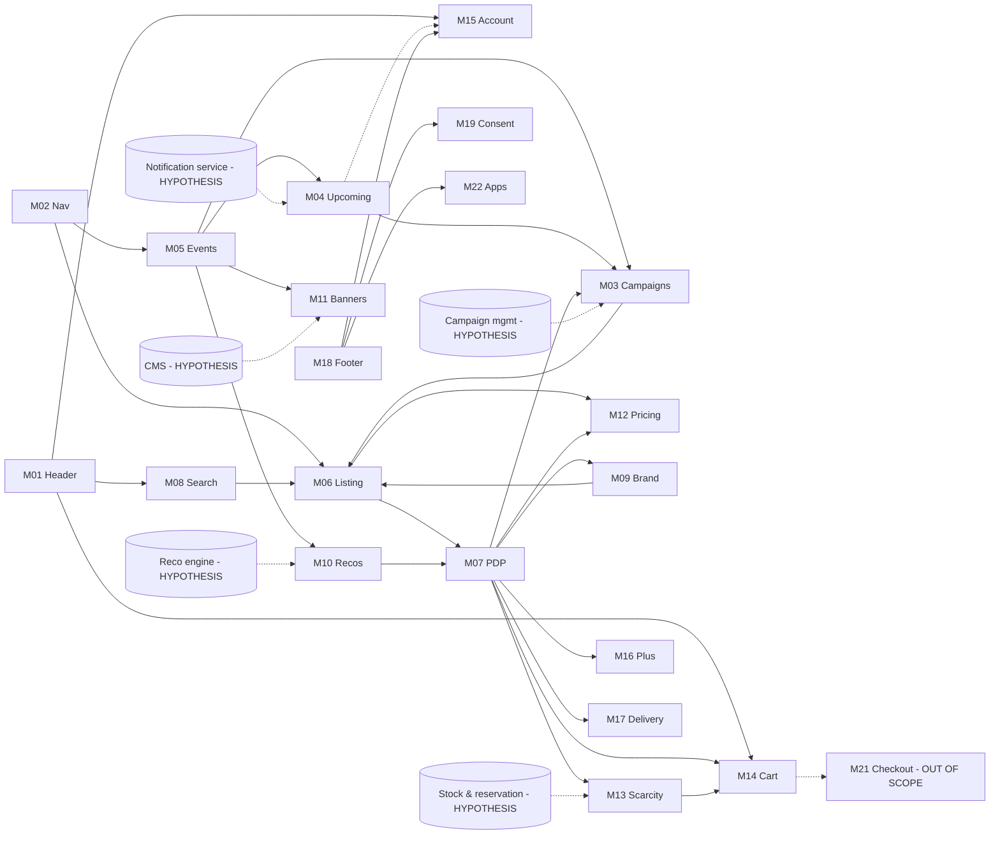

# Module dependencies — Phase 02

An edge **A → B** means A uses data or UI from B. Edges are CONFIRMED where they come from an observed link or shared component, and HYPOTHESIS where they're inferred. Back-office nodes are HYPOTHESIS: they aren't observable.

Solid lines are CONFIRMED (link or shared UI observed). Dotted lines are HYPOTHESIS. M20 (analytics) touches every module and is left out of the diagram for readability.

## Core domain entities implied by the dependencies
These are for the Laravel/MySQL design. Each one is a candidate, labelled by how much of it was observed.

| Entity | Evidence | Class |
|---|---|---|
| Event (landing) | numeric ID, title, hero, ordered campaign list | CONFIRMED (fields as displayed) |
| Campaign | ID `ZZO….`, name, image, start, end, headline % or "Special", product set | CONFIRMED (display) / HYPOTHESIS (stored fields) |
| Event ↔ Campaign | many-to-many (BR-03-13) | CONFIRMED |
| Product / model | model code (e.g. `NI112P025`), brand, attributes | CONFIRMED (display) |
| SKU / article | `H1X44A00D-A11`, campaign-scoped URL, RRP, sale price, sizes, stock hint | CONFIRMED (display) |
| Campaign ↔ article | campaign-scoped addressing (BR-03-01). One model can be in many campaigns (BR-03-14) | CONFIRMED |
| Brand | code `H1X`, name | CONFIRMED |
| Category | numeric ID tree (sitemap §3) | CONFIRMED |
| Upcoming subscription | the "Informez moi" button | HYPOTHESIS (entity not observable) |
| Cart reservation | 20-minute timer, "Réservé" group, release on remove (M14 BR-14-01..03) | CONFIRMED |
| Order fee | 3,90 € per order (BR-12-06) | CONFIRMED (help text) |
| Member preferences | newsletter frequency, saved size filters per gender/group (M15) | CONFIRMED |

## Build-order implication (dependency-driven)
1. Category, Brand
2. Product/SKU
3. Campaign (+ article assignment)
4. Event (+ campaign assignment)
5. Listing/filter API
6. PDP
7. Search
8. Upcoming/notify
9. Recommendations
10. Cart/checkout (separate spec, see Q-04)
